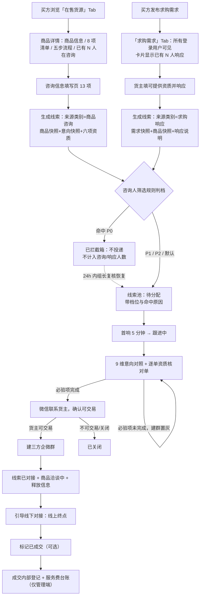
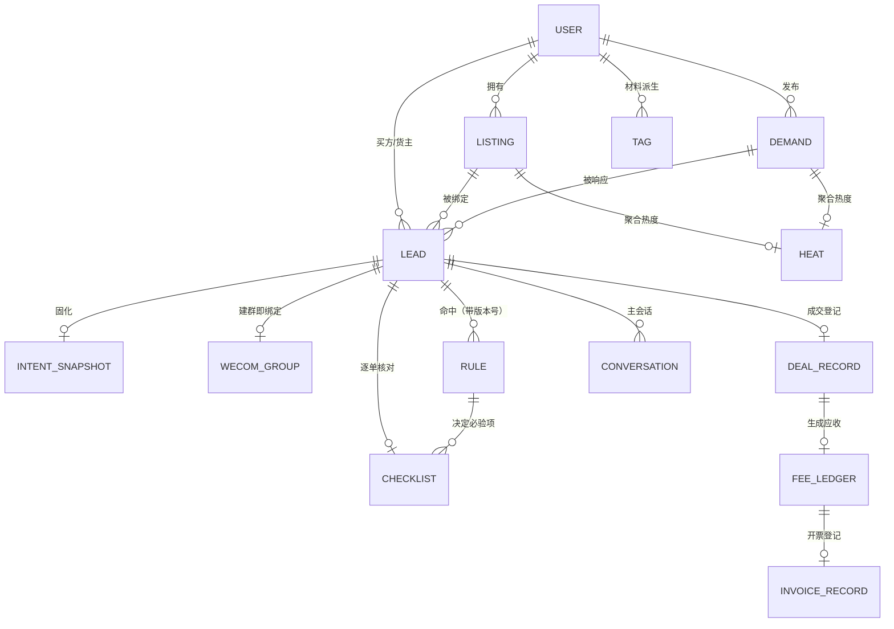

# 算力聚合 — 整体逻辑设计 v3.2（对齐 PRD v1.5）

> **模式**：居间信息中介，形态对标闲鱼。平台只做信息展示、搜索排序筛选、咨询填写、咨询人筛选、意向对照、客服撮合与建三方企微群；**引导线下对接即线上终点**，签约、付款、交付、售后全部在线下由双方自行完成。
> **唯一真源**：《算力聚合-PRD v1.5》（已定稿）。本文与 PRD 冲突时以 PRD 为准；本文不新增 PRD 之外的功能、数值或承诺。
> **文件沿革**：v3.0（三方电子签 + 平台到场见证 + 服务单）→ v3.1（线索制 + 三方企微群 + 内部台账）→ v3.2（发布三分 + 双 Tab 信息流 + 咨询只进管理端 + 咨询人筛选规则 + 逐单资质核对单 + 货主侧只读）。

---

## 0 文档定位与变更

本章解决"这份文档是什么、旧文档哪些结论已经作废、读它时应按什么顺序"。

### 0.1 定位

| 项 | 内容 |
|---|---|
| 文档性质 | 平台整体逻辑设计（业务规则与流程的系统化描述），不是接口文档、不是排期表 |
| 上游依据 | 算力聚合 PRD v1.5（定稿，2026-10-28）；旧版设计 v3.1 仅作结构参考 |
| 覆盖范围 | 角色、对象、双链路撮合、状态机、信息隔离、管理端内部台账、技术底线摘要、取值基线 |
| 不覆盖 | 接口定义、数据库 DDL、埋点方案、运营 SOP 细则 |
| 术语纪律 | 只使用 PRD 词汇：线索、商品、求购需求、咨询热度、咨询人筛选规则、逐单资质核对单、意向对照、三方企微群、成交内部登记、服务费台账；**不出现"订单""服务单""合同中心"** |

### 0.2 v3.0 → v3.1 变更对照（历史）

| 维度 | v3.0（已废弃） | v3.1（历史） |
|---|---|---|
| 平台动作终点 | 电子签 → 披露 → 到场见证 → 结算开票 | **建三方企微群 + 引导线下对接**，线上即终点 |
| 工作单元 | 服务单（consulting→…→completed 七态） | **咨询线索**（待分配→跟进中→已对接→已成交→已关闭） |
| 对接通道 | 客服居中释放联系方式 | 坐席拉**三方企微群**（坐席 + 货主联系人 + 买方联系人） |
| 合同 | 三方居间协议 + 电子签 SDK + 存证 | 平台**不提供签署能力**，合同由双方在站外自行签署 |
| 线下 | 平台派员到场、现场单据、见证栏 | **不派人、不到场、不签现场单据、不做远程见证** |
| 收费 | 1% 居间服务费 + 线下服务费分列 | **仅 1% 居间服务费**，最低 200 元/整单，线下对公转账 |
| 用户侧账单 | 应收、核销、开票在用户侧可见 | **买方与货主侧无账单、无收款页、无发票入口** |
| 交易发起 | 仅"买方看货→咨询"单向 | **双链路**：商品咨询 + 求购响应，线索处汇合，同一套流程 |
| 商品详情 | 规格 + 自由流程 + 标签 | 固定四块：商品信息 / 8 项关键信息清单 / 固定五步流程 / 咨询入口 |
| 意向采集 | 联系客服时口头对信息 | **13 项信息填写页**（需求 5 项必填 + 8 项选填），提交即快照 |
| 买方资质 | 四项标签摘要 | **六项资质摘要**，两条链路口径一致 |
| 技术章节 | 无 | 新增第 9 章技术与非功能底线摘要，10 条不达标不上线 |

### 0.3 v3.1 → v3.2 变更对照

| 维度 | v3.1 | v3.2（本版） |
|---|---|---|
| 形态 | 商品单向信息流 | **对标闲鱼**：首页固定「在售货源 / 求购需求」两个 Tab，不做混排 |
| 发布类型 | 只有「商品」 | **发布类型三分**：出售 / 出租 / 求购；出售与出租都进「在售货源」，求购进「求购需求」 |
| 交易方式 | 计价单位隐含 | **显式「交易方式」字段**；出售按整单价 × 数量且无押金，出租按计价单位单价 + 最短租期 + 押金 |
| 咨询去向 | 三端分发（管理端 + 货主 + 买方） | **只投递到管理端线索池**；货主不再收到单条咨询 |
| 咨询人筛选 | 无 | **咨询人筛选规则引擎**：P0 拦截 / P1 待核 / P2 优先 / 默认，作用域全局 / 品类 / 单商品 |
| 咨询热度 | 无 | 商品卡片与详情页展示**精确去重咨询人数**；P0 拦截不计入 |
| 货主侧可见 | 意向卡片 + 六项资质摘要 + 可交易确认 + 婉拒 + 24h/48h 时限 | **只读降级**：只有去重咨询人数 + 六维资质分布计数 + 最近咨询时间；无列表、无身份、无操作按钮 |
| 资质核对 | 无 | **逐单资质核对单**：买卖双方各一份，6 种验证方式，必验项未完成不可建群 |
| 关键节点 | 三节点 | **四节点**：资质核对完成 / 确认可交易 / 确认成交 / 线下签约完成 |
| 线索状态 | 待分配 / 跟进中 / 已对接 / 已成交 / 已关闭 | 新增 **已拦截**（P0 命中后不投递、不计热度，24h 组长复核或 30 天自动清理） |
| 术语 | 求购单 / 需求大厅 | **求购需求 / 求购需求 Tab** |

### 0.4 阅读顺序

先读第 1 章红线（所有功能的前置约束），再读第 2 章角色与对象，然后按第 3–7 章看端侧与撮合，第 8 章看状态机与数据模型，第 9 章看工程底线，第 12 章查取值。

---

## 1 五条红线

本章解决"平台绝对不能做什么"，任何功能与红线冲突时功能让步。

| 红线 | 具体含义 | 产品上的体现 |
|---|---|---|
| 一、不归集资金 | 不代收、不冻结、不设资金池、不做分账 | 无支付下单流程；货款由买方直接付给货主；平台只收 1% 服务费，由承担方（默认买方，可约定货主承担或按比例分担）**线下对公转账**，财务只在管理端内部台账登记 |
| 二、不担保履约 | 不承诺设备存在、规格真实、按时交付、可退款 | 无"保真""兜底""先行赔付"话术；无下单、无担保交易、无平台见证；违约责任由双方自行签署的合同约定 |
| 三、不背书材料真伪 | 仅登记提交状态，不做真伪核验 | 标签只写"已上传"；统一免责角标不可折叠；平台不检查、不抄录、不运行设备 |
| 四、不公开双方信息 | 信息不公示、不批量可见，只在撮合成立时由客服建群释放 | 联系方式不进任何列表页与搜索结果；建群逐条人工触发并全量留痕；群成员固定三方 |
| 五、居间主体统一为公司 | 签约主体 = 收款主体 = 开票主体 | 禁止个人名义收取服务费；服务费只进对公账户 |

### 1.1 红线四的产品化延伸

信息释放只有一种途径：**建一个三方企微群**。建群即释放，没有第二种。上线前用三个问题自查：

1. **谁建的群**——必须是平台企业微信坐席、且是该线索的负责坐席，逐条人工触发；不允许自动建群，不允许转授建群权限。
2. **群里看到什么**——只有「公司名 + 联系人 + 电话/企微名片 + 资质摘要（买方）/ 货主标签摘要（不含材料原件）」，加上建群时自动推送的意向对照摘要。
3. **能不能查清**——必须能还原"谁、何时、把哪两方拉进了哪个群"，否则不允许上线。

### 1.2 群是信息释放的容器，不是交易场所

群内沟通发生在平台之外，平台不解析、不转录、不据此裁决。平台在群里只做流程协调与信息对齐：推对照摘要、催回填节点、记录结果。**群内达成的约定必须回到站内被登记，否则不算数。**

---

## 2 端与角色

本章解决"谁在用、以什么身份用、管理端谁能看什么"。

### 2.1 单端双身份

平台只有一个用户体系，不分买家 App / 卖家 App。同一账号在货主身份与买方身份间切换：拥有商品时出现「货主工作台」，发起咨询或发布求购时进入「买方中心」。

| 维度 | 规则 |
|---|---|
| 身份切换 | 同一账号可随时切换，不重复注册 |
| 自成交拦截 | 同一实名主体同时作为买方与货主参与同一笔交易时，撮合环节拦截并标记自成交；该线索不计成交记录、不产生服务费 |
| 实名要求 | 浏览、搜索、筛选、看详情不需要实名；发起咨询、上架商品、发布求购需求要求实名（P1 申请验资亦要求实名） |
| 多账号 | 同一实名主体可有多个登录账号，但只有主账号可作为居间服务的委托方联系人 |

### 2.2 管理端角色（六类）

| 角色 | 可执行 | 不可执行 |
|---|---|---|
| 超级管理员 | 全部业务读写与全部管理动作；开通/停用账号、调整角色 | 代为填写买方咨询、改写已提交的咨询快照 |
| 客服主管 | 分配/转接线索、看全部会话与对照、建群与接管重建、代标记成交、代下架、作废成交内部登记、质检、导出报表、**维护咨询人筛选规则（全局 / 品类）、复核已拦截线索（24h 内恢复或维持）、驳回重填核对单** | 调整角色、核销服务费 |
| 客服坐席 | 处理分配给自己的线索：首响、核对对照、**填写逐单资质核对单**、联系货主、建群、回填节点、提交成交内部登记、代下架（限自己线索关联商品）、**对已拦截线索提交复核申请** | 看他人线索、看全部台账、核销、为他人线索建群、**改筛选规则、自行恢复已拦截线索** |
| 审核员 | 商品形式审核 | 接触用户会话 |
| 财务 | 服务费台账、到账登记、核销、开票结果登记 | 接触会话正文 |
| 只读观察者 | 看板与报表 | 任何写操作；看会话正文、联系方式、材料原件 |

### 2.3 关键权限矩阵（摘要）

| 数据 / 动作 | 货主 | 买方 | 坐席 | 主管 | 审核员 | 财务 | 只读 | 超管 |
|---|---|---|---|---|---|---|---|---|
| 商品规格与定价 | 读写自己的 | 只读全部 | 只读 | 只读 | 只读 | 不可见 | 只读 | 读写 |
| 机房名称 | 读写自己的 | 不可见 | 只读 | 只读 | 只读 | 不可见 | 只读 | 读写 |
| 对方联系方式 | 建群后由对方在群内披露 | 同左 | 可见（手机号必展示） | 可见 | 不可见 | 不可见 | 不可见 | 可见 |
| 建三方企微群 | 不可 | 不可 | 可（自己线索） | 可（全部） | 不可 | 不可 | 不可 | 可 |
| 意向快照 | **不可见**，只计入六维分布计数 | 自己的只读 | 只读，更正以追加附注 | 同左 | 不可见 | 不可见 | 不可见 | 只读 |
| 咨询热度（去重人数） | 只见自己商品的聚合值 | 只见商品的聚合值 | 可见 | 可见 | 不可见 | 不可见 | 只读 | 可见 |
| 单条咨询记录 | **不可见**（无列表、无摘要、无身份） | 只见自己的 | 可（自己线索） | 可（全部） | 不可 | 不可 | 不可 | 可 |
| 查看意向对照 | **不可见** | 只读自己的 | 可（自己线索） | 可（全部） | 不可 | 不可 | 不可 | 可 |
| 咨询人筛选规则 | 不可见 | 不可见 | 可读、可发起单商品规则（须主管确认） | 可读写（全局 / 品类） | 不可见 | 不可见 | 不可见 | 可读写 |
| 逐单资质核对单 | **不可见** | **不可见** | 填写（自己线索） | 查看、驳回重填 | 不可见 | 不可见 | 不可见 | 查看 |
| 材料原件 | 自己的 | 自己的 | 可见（仅平台内） | 可见 | 不可见 | 不可见 | 不可见 | 可见 |
| 求购需求 | 只读摘要 + 六项资质 + N 人已响应 | 读写自己的 | 读写 | 读写 | 不可见 | 不可见 | 只读 | 读写 |
| 响应求购需求 | 可（须绑定在售商品） | 不可 | 不可 | 不可 | 不可 | 不可 | 不可 | 可 |
| 成交内部登记 | 不可见 | 不可见 | 可（自己线索） | 可（全部） | 不可见 | 只读 | 不可见 | 可 |
| 服务费台账 | 不可见 | 不可见 | 见自己线索关联部分 | 只读 | 不可见 | 读写 | 不可见 | 读写 |

### 2.4 坐席机制

1. 一个客服账号对应一个坐席、一个企业微信坐席账号，**线索必须绑定唯一坐席**；建群只能由该线索负责坐席或主管执行。
2. 新线索按在线坐席负载轮询分配；主管可手动转接，转接留痕；同一线索转接超过 3 次标记"责任不清"并强制主管接手。
3. 坐席下线后线索回到待分配池，并自动向用户发送「客服稍后回复」。
4. 首响 SLA：新咨询 5 分钟内必须首次响应，超时标红并升级主管；线索 30 分钟未分配升级主管。
5. **状态推进权唯一**：线索状态只由系统按筛选规则与坐席动作推进；**货主与买方都不能推进状态**。买方只能提交咨询、补充材料、撤销求购需求；货主只能提交商品（上架 / 下架 / 标记已成交）与响应求购需求，**不接收单条咨询、没有「接受 / 拒绝 / 报价」按钮**。唯一例外是货主标记自己商品已成交，直接触发线索转「已成交」与商品转「已成交」。
6. **咨询只有一条入口、一个终点**：所有咨询（含求购响应）都只落到管理端线索池，由坐席用平台企业微信联系双方；站内不存在任何用户之间的对话通道。

---

## 3 货主侧

本章解决"货主如何把非标算力标准化上架、如何响应求购需求、哪些信息不能外露"。

### 3.1 发布类型三分与五步上架

发布第一步先选**发布类型**，选完即决定后续表单与信息流归属：

| 发布类型 | 面向 | 结构化字段差异 | 落在哪个 Tab |
|---|---|---|---|
| 出售 | 买方买断整机 / 整批 | 交易方式=出售；整单价（元/台或元/件）+ 可售数量；可设批量档位；**无押金字段** | 在售货源 |
| 出租 | 买方按周期租用 | 交易方式=出租；计价单位（卡时 / 机日 / 机月 / 整包）+ 单价 + **最短租期** + **押金**；可设长期租期折扣档与整包价 | 在售货源 |
| 求购 | 买方发布自己需要什么 | 走求购需求表单（见 4.9）；不进商品池、不参与「在售」状态 | 求购需求 |

出售与出租共用同一套五步上架（求购不走五步）：

| 步骤 | 内容 | 规则 |
|---|---|---|
| ① 基本信息 | 发布类型、交易方式、规格、成色、税费、供给类型、定价 | 必填齐全，可保存草稿 |
| ② 材料登记 | 8 项关键信息 + 其他材料 | 可跳过；未上传项常驻显示"未上传" |
| ③ 交易城市 | 城市 + 可选区域 | **只到城市级**，不选具体场所 |
| ④ 交易说明 | 货源说明、交付方式、验收标准、售后、付款方式（仅声明） | 货源说明与验收标准必填 |
| ⑤ 提交审核 | 形式审核 | 24 小时内完成；超时提醒审核员与主管，不自动通过 |

任一步未完成，商品停留在「草稿」，不出现在列表中；五步之间可自由回退。进入第 ②、④ 步时，页面顶部固定展示不可关闭提示：**「你提交的材料、承诺项与接单要求，会在商品详情页以『已上传 / 未上传』逐项展示给买方，并显示『已上传 N 项 / 共 8 项』。平台只登记提交状态，不核验真伪。」**

### 3.2 结构化字段

| 分组 | 字段 | 必填 | 可见性 |
|---|---|---|---|
| 算力规格 | GPU 型号、GPU 数量、单卡显存、卡间互联（NVLink / PCIe5 / 无）、CUDA 版本、CPU 型号与核心数、内存、存储、网卡速率、是否独享带宽、公网 IP 数量 | 是 | 买方可见 |
| 成色 | 全新 / 二手 / 拆机件 / 翻新 / 其他；二手与拆机件须补使用时长、来源说明 | 是 | 买方可见 |
| 税费 | 含税 / 不含税 / 可开专票 / 可开普票、税率、发票类型、抬头要求 | 是 | 买方可见 |
| 供给类型 | 现货 / 期货；期货须填可交付时间、批量上限、违约处理方式（仅登记） | 是 | 买方可见 |
| 定价 | **交易方式（出售 / 出租）**、整单价或计价单位单价、可售数量 / 最短租期 / 押金、是否可议价、多档位、账期 | 交易方式与对应单价必填；出租须填最短租期与押金 | 买方可见 |
| 交易城市 | 城市、所在区域 | 城市必填 | 买方可见 |
| 机房信息 | 机房所在城市、等级（T1–T4）、运营商 | 城市与等级必填 | 买方可见（不含机房名称与机柜位置） |
| 机房名称 | 具体机房 / 园区名称 | 否 | 仅平台与货主 |
| 交易说明 | 货源说明、交付方式、验收标准、售后天数与 SLA、付款方式 | 货源说明与验收标准必填 | 买方可见 |
| 接单要求 | 对买方的资质要求、可承接数量上限、要求的使用周期范围 | 否 | 平台与货主；意向对照时向买方展示 |
| 承诺项 | 支持同台核验 / 支持先验后付 / 支持短周期试用 | 否 | 买方可见 |
| 材料 | 所有权证明、设备图片、规格文档、第三方报告、其他 | 否 | 只见「已上传 / 未上传」；设备图片可见缩略图，其余不展示内容、不提供下载 |

**成色、税费、供给类型**三项同时进入筛选器与商品卡片首行；选"其他"须显示货主补充说明；选"不含税"显示角标并提示买方自行考虑税费差异，**平台不做加价换算、不给建议**。

### 3.3 价格设定

- **出售**：整单价（元 / 台或元 / 件）+ 可售数量必填；可设批量档位（起订量档 → 单价）与议价标记；**出售不出现押金字段**。
- **出租**：计价单位（卡时 / 机日 / 机月 / 整包）、单价、**最短租期**、**押金**必填；可设长期租期折扣档、整包价、账期。
- 多档位校验：档位价格必须单调（数量越大 / 租期越长单价越低），保存时校验，违反则提示调整。
- 期货商品必须设期货价；现货与期货同框展示时计价口径必须一致，否则不进入价格排序与筛选。
- 押金、账期为出租的选填/必填声明项，**仅作声明**：平台不代收押金、不提供账期结算。
- 价格修改只影响之后的新咨询；已生成线索保留咨询当时的商品快照。

### 3.4 交易地点只到城市

货主只填交易城市与可选区域，不选机房、会议室、咖啡厅等具体场景；机房名称只留平台内部。具体交付地点与方式由双方线下自行约定，平台不指定、不安排，全程不记录详细地址与现场联系人。

### 3.5 形式审核

| 审核项 | 判定 |
|---|---|
| 字段完整性 | 必填齐全、规格自洽（如卡数与显存明显矛盾） |
| 成色与税费自洽 | 二手/拆机件未填使用时长与来源；期货未填可交付时间；标"含税"未填税率 |
| 价格合理性 | 明显偏离市场价的异常值；多档位价格不单调 |
| 违规内容 | 诈骗话术、违禁品、"包过""稳赚"等不当表述 |
| 类目匹配 | 描述标的与"算力出租/出售"一致 |
| 重复铺货 | 同一货主重复发布高度雷同商品 |

**不审核**：材料真伪、设备是否真实存在、权属是否真实、成色是否属实、是否真的含税（须在服务协议写明）。驳回须填具体原因，货主可在原草稿上修改后重提。

### 3.6 商品七态

| 状态 | 含义 | 买方可见性 | 可执行操作 |
|---|---|---|---|
| 草稿 | 未提交 | 不可见 | 编辑、删除、提交 |
| 待审核 | 已提交待审 | 不可见 | 撤回（回草稿） |
| 在售 | 可正常咨询 | 可见可咨询 | 编辑、下架 |
| 洽谈中 | 已被某条线索占用 | **可见**，咨询入口置「洽谈中」 | 货主下架；货主或客服标记已成交 |
| 已成交 | 已标记成交 | 可见（标注已成交） | 仅查看；可复制为新商品 |
| 已下架 | 货主主动下架 | 不可见 | 重新上架 |
| 已驳回 | 形式审核未通过 | 不可见 | 修改后重提 |

流转规则：

1. **咨询不改变商品状态**；买方发起咨询后商品仍「在售」，线索进「待分配」。
2. 建群时的三动作不可拆分：**线索转「已对接」+ 商品转「洽谈中」+ 群记录落库**。
3. **洽谈中不隐藏商品**，仅咨询入口不可用（P1 起追加「登记候补」入口）。
4. **同一商品同一时刻只允许一条线索处于「已对接」**；并发时后进入者被阻塞并提示客服介入。
5. 标记已成交必须关联线索并填成交金额；该金额仅为线索侧预估，**最终计费以成交内部登记金额为准**。
6. 洽谈中超过 **7 天**未推进，仅提醒货主与坐席，**不自动回滚**。
7. 已成交不可改回在售；剩余资源用「复制为新商品」重走审核。
8. 线索关闭且未成交时，洽谈中商品恢复「在售」；货主已主动下架的保持「已下架」。

谁可操作：货主可下架自己的商品，并在「洽谈中」标记已成交（须关联该商品唯一处于「已对接」的线索并填金额）；坐席可代下架、代标记（限自己线索关联商品）；主管可操作全平台；审核员不参与。

### 3.7 标签体系

标签只能由事件自动派生，用户不可自贴、不可编辑、不可购买；只回答"提交了什么、何时提交"。

| 层级 | 定义 | 典型标签 | 产生方 |
|---|---|---|---|
| L1 已提交 | 对方自己上传 | 已上传《所有权证明》《设备图片》《规格文档》 | 用户上传即生效 |
| L2 第三方出具 | 外部机构结论，平台只转述"提供了某机构结论" | 已提供《验资报告》《审计报告》《公证书》 | 第三方机构 |
| L3 历史成交 | 平台自己的记录 | 已成交 N 单、近 90 天成交 M 单 | 线索标记已成交后累计 |

P0 的 L3 只含成交笔数；「无纠纷记录」「好评率」需评价与纠纷机制支撑，P0 不上线。

**货主标签（买方全程可见）**：已上传《所有权证明》/《设备图片》/《规格文档》/《第三方报告》、支持同台核验、支持先验后付、支持短周期试用、未上传补充材料（兜底）。

**展示规则**：卡片只展示最高层级 + 该层前 2 个标签（如「L3 · 已成交 12 单」）；L2 必须带出具机构名称；不展示材料原件与内容，只给"有/无、类型、时间"；详情页 8 项清单与本标签**同源派生**，不得出现一处"已上传"、另一处"未上传"。

**统一免责角标（原文，不可折叠、不可关闭）**：

> 本页标签仅表示该卖方已提交相应材料，平台未核实其真实性，亦未对设备作任何检查、鉴定或担保。请自行判断并核实。

**时效与降级**：

| 材料类型 | 有效期 | 到期动作 |
|---|---|---|
| 所有权证明（发票 / 合同） | 长期 | 超 12 个月加「已陈旧」角标，不失效 |
| 资金证明 / 存款证明 | 3 个月 | 降级「已过期」置灰 + 重新上传提醒 |
| 营业执照 | 随工商登记 | 每年复核一次 |
| 第三方报告 / 验资结论 | 6 个月 | 降级「已过期」 |
| 设备图片 | 12 个月 | 降级「已陈旧」 |

降级不撤销（保留并显示上传时间）；到期前 30 天与当天各提醒一次；降级影响排序权重，不影响在售资格。

### 3.8 货主侧咨询可见范围（只读降级）

货主**只能看到自己商品上的聚合热度**，看不到任何一条咨询；平台与货主之间的沟通全部走企微或客服通道。

| 环节 | 规则 |
|---|---|
| 咨询人数 | 本商品**精确去重的咨询人数**，只统计通过筛选、未被 P0 拦截的有效咨询；实时刷新 |
| 六维资质分布 | 已实名 / 强主体 / 可验资 / 已提供验资视频 / 接受同台验收 / 已提供要求材料，六项逐项给人数；**任一项 < 3 人时合并展示「其他」**，防排除法反推 |
| 咨询时间 | 只给「最近一次咨询时间」与近 7 天趋势，不给时间点列表 |
| 不展示 | 单条咨询、需求摘要、买方身份、联系人与联系方式、材料原件 |
| 无操作按钮 | 没有「接受 / 拒绝 / 报价 / 回复」；货主不需要在站内做「确认可交易」 |
| 平台何时联系 | 坐席按筛选档位与核对结果，用平台企业微信主动添加货主询问是否可交易，结果回填站内节点 |
| 与平台沟通 | 只走客服通道；任何阶段都不提供联系买方的入口 |

### 3.9 求购需求 Tab 与响应求购需求

| 规则 | 内容 |
|---|---|
| 可见内容 | 对**所有登录用户**公开需求摘要（规格、数量、预算、周期、城市、税费与成色要求、验收要求）+ 六项资质摘要 + N 人已响应 |
| 不可见 | 买方公司名、联系人与联系方式、材料原件；不进站外搜索索引；需求卡片只显示"某企业（已实名）" |
| 响应前提 | 必须绑定**货主自己的一条「在售」商品**，不支持"无商品响应"；无在售商品时引导先上架；响应时须已实名 |
| 响应动作 | 可附 **≤200 字**条件说明；提交即生成「求购响应」类别线索 |
| 响应去向 | **只投递到管理端线索池**，先过与商品咨询同一套咨询人筛选规则，再进同一套撮合流程 |
| 响应人数 | 需求卡片展示精确去重响应人数，P0 拦截不计入；不展开名单 |
| 唯一性 | 同一货主对同一求购需求只允许一条线索，重复响应合并到原线索并追加记录 |
| 需求详情页 | 不提供留言、不提供联系方式；唯一动作是「响应需求」 |
| 响应不改商品状态 | 商品仍「在售」，只有建群时该商品才转「洽谈中」 |

---

## 4 买方侧

本章解决"买方如何浏览两条信息流、看什么、怎么发起咨询或反向发布求购需求"。

### 4.1 浏览与可见边界

浏览不设门槛：未登录、未实名、未提交任何材料均可浏览、搜索、筛选全部商品。产品中**没有"下单""立即购买""加入订单"**，唯一转化入口是「咨询客服」。

首页固定**两个 Tab**，不做混排：

| Tab | 内容 | 卡片主要要素 |
|---|---|---|
| 在售货源（默认） | 出售 + 出租两类商品，卡片用双色标签区分「出售 / 出租」 | 型号、数量、单卡单日价（出租显示「起租 N 天」）、城市、成色 / 税费、**N 人在咨询**、资质 chips |
| 求购需求 | 买方发布的需求 | 型号、数量、预算区间、城市、期望时间、**N 人已响应** |

两个 Tab 都可直接浏览，不登录也能看；只有「咨询客服」与「发布求购需求」需要登录并实名。

| 字段 | 可见 | 说明 |
|---|---|---|
| 交易方式（出售 / 出租） | 是 | 卡片双色标签，出租另显示最短租期 |
| 算力规格、成色、税费、供给类型、档位价 | 是 | 商品卡片首行显示成色 / 税费 / 现货期货 |
| 交易城市与区域 | 是 | 不展示具体场所 |
| 机房所在城市、等级、运营商 | 是 | 不展示机房名称与机柜位置 |
| 货主标签 | 是 | 含统一免责角标 |
| 8 项关键信息清单 | 是 | 只有「已上传 / 未上传 / 支持 / 未声明」，不展示内容 |
| 固定五步交易流程 | 是 | 固定文案，所有商品一致 |
| 咨询热度 | 是 | 只给**精确去重的咨询人数**与「M 人可验资」这类汇总提示，不给名单、不给头像 |
| 货主公司名 / 联系人 / 联系方式 | 否 | 建群后仅在该线索内可见 |
| 材料原件与内容 | 否 | 任何阶段都不展示 |
| 咨询人身份与联系方式 | 否 | 买方看不到其他咨询人，货主也看不到；一切由平台对接 |

### 4.2 搜索

| 规则 | 说明 |
|---|---|
| 主检索字段 | GPU 型号（首要）、CPU 型号、城市、品牌 |
| 别名归一 | H100 / H100 SXM / H100 80G / H100S → H100；A100 40G / A100 80G → A100-40G / A100-80G；RTX 4090 / 4090 → RTX 4090 |
| 分词 | 空格分隔多词为 AND：「H100 80G 上海」= 型号含 H100 且显存 80G 且交易城市上海 |
| 匹配范围 | 商品名、型号、规格描述、机房城市、交易城市、交易说明正文 |
| 空结果 | 提示"没有完全匹配的货源"，给出去城市 / 放宽显存 / 去标签筛选的入口，并引导发布求购需求 |

### 4.3 筛选（两个 Tab 两套独立筛选器）

**在售货源 Tab（买方筛货）**：GPU 型号（多选，含在售数量）、交易方式（出售 / 出租）、GPU 数量区间、单卡显存（24G / 40G / 48G / 80G / 96G 及以上）、卡间互联、交易城市（多选，城市级）、成色、税费、供给类型、计价方式、价格区间（折合单卡单日价）、标签（含 L3）、承诺项。

**求购需求 Tab（卖方筛需求）**：所需型号（多选，含开放需求数）、需求数量区间、单卡显存、卡间互联、预算区间（随计价方式切换口径）、计价方式、使用周期（开始时间 + 时长分段）、交易城市、税费要求、成色要求、验收要求、需求状态（默认只选「开放」）。维度**全部对应求购需求自身字段**，不含任何买方身份、公司名或资质维度——资质摘要只在卡片与详情页展示，不能作为筛选条件。

两套条件各自独立保存，切换 Tab 回到该 Tab 上一次的条件；筛选不改变列表顺序，也不改变货主能否发起咨询（界面文案统一为「发起咨询」，后台来源类别仍为「求购响应」）。

交易方式、成色、税费、供给类型为在售货源 Tab 的高频筛选项；所需型号、预算区间、交易城市、使用周期为求购需求 Tab 的高频筛选项，**均在筛选面板中默认展开**，不折叠到"更多筛选"。

### 4.4 价格归一化与排序

| 计价单位 | 折算公式 | 说明 |
|---|---|---|
| 卡时 | 单价 ÷ 卡数 ÷ 24 | 元/卡·日 |
| 机日 | 单价 ÷ 卡数 ÷ 1 | 元/卡·日 |
| 机月 | 单价 ÷ 卡数 ÷ 30 | 月按 30 天计 |
| 整包 | 单价 ÷ 卡数 ÷ 折算天数 | 按最短租期折算；缺失时不参与价格排序 |

卡片同时展示原始计价方式与单价，折合价仅用于排序与筛选，不作为对外报价。多档位时折合价取**最低可成交档位**，列表须显示「起」，详情页完整展示全部档位。

交易方式不同、口径不同：**出租**按上表折算为元/卡·日参与价格排序；**出售**不折算卡日价，按整单价展示，在「价格排序」中单列一组排在出租之后，不与出租混排比价。

排序项：综合（综合分降序）、价格升序/降序（无折算价排最后）、最新（最近上架时间倒序）、成交优先（历史成交数倒序）。

求购需求 Tab 的排序：最新发布（默认）、预算从高到低（同计价方式内比较，跨口径不排）、开始时间最近；**不提供响应人数排序**，响应人数只做展示。

综合分（满分 100）：型号匹配度 30 + 价格分 25 + 标签分 15 + 城市匹配 10 + 活跃度 10 + 成交热度 10。**咨询人数与六维资质分布只做展示，不进入任何权重**，避免货主为刷热度而堆咨询。

### 4.5 商品详情四块（顺序不可调整）

| 区块 | 内容 |
|---|---|
| ① 商品信息 | 交易方式（出售 / 出租，出租另显示最短租期与押金口径）、结构化规格、成色、税费、供给类型、多档位价格、交易城市、机房城市与等级、交易说明、货主标签（含免责角标） |
| ② 关键信息是否已上传 | 固定 8 项逐项列出，只有「已上传 / 未上传 / 支持 / 未声明」；上方一行「已上传 N 项 / 共 8 项」，只给计数，不给评分、等级、推荐 |
| ③ 商品交易流程 | 固定五步，所有商品一致，不可由货主自定义；不含期限承诺、担保表述与结果承诺 |
| ④ 咨询入口 | 按钮固定「咨询客服」，按钮上方一行「**已有 N 人在咨询**（去重）」，下方紧临「**你填写的信息越完整，平台越能优先把你对接给合适的货主**」；**不提供任何联系货主或查看咨询人的入口** |

8 项清单与来源：

| 关键信息 | 来源 | 已上传时 | 未上传时 |
|---|---|---|---|
| 所有权证明 | 货主材料登记 | 不展示文件与内容，只登记状态 | 未上传 |
| 设备图片 | 货主材料登记 | 图片可见，不标注拍摄时间与地点 | 未上传 |
| 规格文档 | 货主材料登记 | 不提供下载，仅登记状态 | 未上传 |
| 第三方检测 / 验收报告 | 货主材料登记 | 只写「已提供某机构出具的报告」，不复制结论 | 未上传 |
| 支持同台核验 | 货主承诺项 | 在交易城市同台验机 | 未声明 |
| 支持先验后付 | 货主承诺项 | 具体比例与节点由双方线下约定 | 未声明 |
| 支持短周期试用 | 货主承诺项 | 起租周期与试用价见档位价 | 未声明 |
| 接单要求 | 货主填写 | 原文展示（如"需提供验资报告"） | 未填写 |

固定五步：

`提交咨询（填写需求与可提供材料）→ 平台核对（过咨询人筛选规则 + 逐单资质核对 + 微信联系货主确认可交易）→ 建三方企微群（坐席 + 货主 + 买方）→ 线下看货验机（时间地点由双方在群内约定）→ 线下签约与付款（平台不参与、不担保）`

流程下方固定一行免责文案：**「平台仅提供信息发布与居间对接，不参与交易、不担保履约、不核验材料真伪。」**

### 4.6 咨询信息填写页（13 项）

点击「咨询客服」后**不直接进会话**，先看信息填写页。需求 5 项必填，其余 8 项选填（联系人手机号必填）。

| 分组 | 字段 | 必填 | 说明 |
|---|---|---|---|
| 需求规格 | 所需 GPU 型号、所需卡数、所需单卡显存、是否需要特定互联、单卡或整机 | 是 | 与商品规格对照的第一维度 |
| 使用周期 | 起始时间、预计时长 | 是 | 与现货/期货、档期对照 |
| 预算 | 总预算或单卡单日价区间、计价单位 | 是 | 与档位价对照 |
| 交易城市 | 可接受城市，多选，城市级 | 是 | 与商品交易城市对照 |
| 税费要求 | 是否必须含税、是否需要专票 | 是 | 与货主税费设置对照 |
| 成色要求 | 是否接受二手/拆机件、可接受最高使用时长 | 否 | — |
| 验收要求 | 买方自身验收标准 | 否 | — |
| 补充说明 | 其他条件 | 否 | 自由文本 |
| 主体资质 | 营业执照、法定代表人信息 | 否 | 上传后生成买方标签，不传不阻断 |
| 资金证明 | 资金证明、存款证明、验资报告、审计报告 | 否 | 上传后生成 L2 标签 |
| 验资视频 | 买方自行录制的验资视频 | 否 | 只登记「已提供验资视频」，平台**不播放、不核验、不截图留档**；货主只见标签 |
| 强主体材料 | 上市公司公告、国资名录、财报等 | 否 | 经形式审核生成强主体标签 |
| 联系人 | 姓名、职务、手机号、企业微信号 | 手机号必填 | 用于建群时邀请 |

规则：

- 顶部固定提示（不可关闭）：**「你填写的信息越完整，平台越能优先把你对接给合适的货主。留空不影响提交，但可能排在后面。」** 提交按钮旁显示「已填写 N / 13 项」，只给计数。
- 顶部固定展示当前商品的规格、交易方式、成色、税费、现货期货、档位价格，以及货主接单要求；接单要求中买方未提供对应材料的项，提交前以「未提供」列出，**不阻断提交**。
- 支持暂存草稿与返回修改；同一买方对同一商品**始终只保留一条线索**：24h 内重复咨询合并到原线索，超过 24h 也不新建，只在原线索上追加一条咨询记录（管理端按时间展示）；资质材料不重复上传。
- 提交后内容以**意向信息快照**固化，之后不可被任何人改写；需变更时由坐席在原快照后追加变更附注并留痕。
- 提交即生成线索并**按咨询人筛选规则判档**：命中 P0 的进「已拦截箱」，**不投递、不计入咨询人数、不通知任何人**；其余进入管理端线索池「待分配」，并按 P1 / P2 / 默认给出档位与命中原因。**不向货主投递任何单条咨询**，货主侧只会看到咨询人数 +1 与资质分布变化。

### 4.7 九维意向对照

| 对照维度 | 货主侧（商品快照） | 买方侧（意向信息） | 差值提示（客观） |
|---|---|---|---|
| 型号与显存 | GPU 型号、卡数、单卡显存 | 所需型号、卡数、显存 | 型号不一致 / 显存不一致 / 卡数差 N |
| 成色 | 全新 / 二手 / 拆机件 / 翻新 | 是否接受、可接受使用时长上限 | 在可接受范围内 / 超出范围 |
| 税费 | 含税 / 不含税、税率、可开票类型 | 是否必须含税、是否需专票 | 票种不一致 |
| 供给类型 | 现货 / 期货、可交付时间 | 使用起始时间、时长 | 同为现货 / 期货交付晚于需求起始 N 天 |
| 价格 | 档位价（折合单卡单日价） | 预算区间（折合单卡单日价） | 高于预算上限 N / 低于 N |
| 城市 | 交易城市 | 可接受城市 | 有交集 / 无交集 |
| 数量上限 | 可承接数量上限 | 所需数量 | 需求 N 卡、上限 M 卡 |
| 资质要求 | 接单要求 | 六项资质摘要 | 缺 X 标签 / 要求材料未提供 N 项 |
| 验收标准 | 货主验收标准 | 买方验收要求 | 表述一致 / 不一致（列差异条款） |

对照**只做字段并列与客观差值标注，不做结论判断**：不输出"可以成交""不匹配""推荐推进"。差值由系统按字段规则计算，**是否推进、是否建群由坐席人工判断**。对照视图**只在管理端可见**；货主侧既不看差值，也不看需求摘要，只看到咨询人数与六维资质分布计数。

### 4.8 六项买方资质摘要（管理端逐条 / 货主侧只见分布计数）

同一套六项，两个可见口径：

- **管理端**：在咨询详情页看到六项**逐条**取值，用于判档、核对与决定优先推荐谁。
- **货主侧**：只看这六项的**人数分布**（如「3 人已实名 / 1 人可验资 / 1 人已提供要求材料」），**不见名单、不见企业名、不见联系方式、不见材料原件**；任一项计数 < 3 时合并为「其他」，防排除法反推。

| 六项 | 取值 | 数据来源 |
|---|---|---|
| 是否已实名 | 是 / 否 | 实名核验结果 |
| 是否强主体 | 是 / 否 | 强主体材料经形式审核 |
| 是否可验资 | 是 / 否 | 「已上传资金证明」或「已提供验资报告」任一成立 |
| 是否已提供验资视频 | 已提供 / 未提供 | 买方上传过验资视频（只登记提交状态） |
| 是否接受同台验收 | 接受 / 未声明 | 买方在「我的资质」页或求购需求勾选 |
| 是否已提供货主要求的证明材料 | 已提供 / 未提供 / 货主未设置接单要求 | 与货主接单要求逐项比对，只比对"有没有提交"，给出 N / M 计数 |

六项固定，两条链路口径一致。买方**始终看不到其他咨询人**，货主**只见分布计数、不见任何一条咨询**。

### 4.9 发布求购需求

触发：买方在空结果页选择「发布求购需求」，或在买方中心主动发布。求购需求发布后进入首页第二个 Tab「求购需求」，对所有登录用户可见。

货主侧视角即「卖家市场」：先用 4.3 的求购需求筛选器缩小范围（型号 / 数量 / 预算 / 周期 / 城市 / 税费 / 成色 / 验收要求 / 状态），再进需求详情页发起咨询。筛选与排序都不改变货主能否发起咨询。

| 字段 | 说明 | 必填 |
|---|---|---|
| 需求规格 | GPU 型号、数量、显存、互联方式、单卡/整机 | 是 |
| 预算区间 | 总预算或单价区间，与计价方式同口径 | 是 |
| 计价方式 | 卡时 / 机日 / 机月 / 整包（求购需求默认按出租口径比价） | 是 |
| 使用周期 | 起始时间、时长 | 是 |
| 交易城市 | 可接受城市，多选，城市级 | 是 |
| 税费要求 | 是否必须含税、是否需要专票 | 是 |
| 成色要求 | 是否接受二手/拆机件、可接受最高使用时长 | 否 |
| 验收要求 | 买方自身验收标准 | 否 |
| 是否上传验资视频 | 上传 / 暂不提供（选上传后生成标签） | 选择必填 |
| 是否接受同台验收 | 接受 / 不接受（选接受后生成标签） | 选择必填 |
| 其他说明 | 补充条件 | 否 |

发布前置：买方须已实名，且在「我的资质」页填写联系人手机号（建群必需）；未填则先引导补全，不生成需求。

**响应去向**：货主在需求详情页点「发起咨询」，**必须绑定自己的一条「在售」商品**作为供给方案，可附 ≤200 字条件说明；同样先过**咨询人筛选规则**（货主侧也要填一份可提供资质），**只投递到管理端线索池，不直接联系买方**；P0 拦截的响应不进买方的响应人数。界面文案统一为「发起咨询」，后台来源类别仍记为「求购响应」。

**响应人数**：求购需求卡片固定显示「**已有 N 人响应**」，精确去重，**不展开名单**。

买方侧反馈：自己的求购需求上只看到「已有 N 家响应，平台正在核对」与线索状态，**看不到货主是谁、是哪件商品**；建群后才在群内互相可见。

### 4.10 买方资质来源

两处、口径同源：① 咨询信息填写页当次提交的材料（随该次咨询固化进意向快照）；② 「我的资质」页维护的材料与勾选项（可随时更新，只影响此后提交的咨询与发布的求购需求）。

买方标签：已完成实名、已上传营业执照、已上传资金证明、已提供验资报告、已提供验资视频、接受同台验收、强主体、未提交材料（兜底）。所有标签只表示"已提交"，平台未核实真伪。

这些标签**只在管理端逐条展示**；货主侧不展示任何逐条标签，只把标签计入六维分布计数（<3 合并「其他」）。

---

## 5 撮合流程

本章解决"两条链路如何汇合到同一套线索流程、建群前后各发生什么"。

### 5.1 两条链路、一套流程

| 来源类别 | 发起方 | 线索必须携带的快照 | 与另一类的差异 |
|---|---|---|---|
| 商品咨询 | 买方 | 商品快照 + 意向信息快照 + 六项资质摘要（管理端逐条） | — |
| 求购响应 | 货主 | 求购需求快照（需求 + 资质摘要）+ 所选商品快照 + 响应说明 | 发起方相反；其余完全一致 |

两类线索在**筛选判档、状态机、分配规则、首响 SLA、资质核对、建群动作、节点回填、成交内部登记、服务费台账上完全一致**，不允许出现两套流程。线索编号统一、不分前缀；工作台按来源类别分 Tab，默认「全部」。线索创建后**来源类别不可修改**，建错只能关闭后重建，原线索保留。

**两条链路的终点相同**：都只落到管理端线索池，由坐席用平台企业微信对接；站内不存在任何用户之间的对话通道。

### 5.2 提交即判档、只投管理端（不做三端分发）

咨询提交后系统做的第一件事是**判档**，不是分发。所有线索（含求购响应）都只有一个接收方：管理端线索池。

| 档位 | 典型触发条件（可在管理端配置） | 系统动作 | 用户侧提示 |
|---|---|---|---|
| P0 拦截 | 命中黑名单、同一手机号 24h 内高频咨询 / 跨多品类刷单、明显无效信息（如手机号位数不符）、命中品类禁用词 | 进**已拦截箱**，不分配、不通知任何人、**不计入咨询人数与响应人数**；货主侧完全无感知 | 买方只看到「已提交」，无任何差别提示 |
| P1 待核 | 未实名、材料明显缺项、手机号与实名信息不一致 | 入池并置顶，标「待核」，坐席优先核实 | 正常提交成功回执 |
| P2 优先 | 已实名 + 强主体 / 可验资 / 已提供验资视频 / 已提供货主要求材料（命中任一） | 入池并**单独高亮、置顶推荐**，即时提醒坐席 | 正常回执 + 「平台会优先对接」 |
| 默认 | 其余全部 | 正常入池排队 | 正常回执 |

判档规则的作用域与优先级：

| 项 | 规则 |
|---|---|
| 优先级 | **P0 > P1 > P2 > 默认**；命中多条时按最高风险档位判定，并把全部命中原因写入线索 |
| 作用域 | 全局 / 品类 / 单商品三级；**单商品级规则只允许 P1 / P2 / 默认，永不升级为 P0**，防货主私设拦截 |
| 命中原因 | 每条线索固定存「命中规则 ID 列表 + 命中时的规则版本号」，供复核与申诉 |
| 变更不回溯 | 规则改动**只对新线索生效**，已判档的历史线索不重算，避免同一线索前后档位漂移 |
| 复核 | P0 线索 24h 内由组长复核，可恢复为「待分配」；超期未复核的 30 天自动清理，留档不留人 |

| 接收方 | 通道 | 内容 | 时限 |
|---|---|---|---|
| 管理端工作台 | 线索池「待分配」+ 桌面声音 + 企微坐席群 | 新咨询条数、商品名与型号、来源类别、**档位与命中原因**、六项资质摘要（逐条）、等待时长；点开进咨询详情页 | 实时，< 3 秒 |
| 货主 | **只推汇总，不推单条** | 只有「咨询人数变化」「六维资质分布变化」这类聚合提醒，**不含需求摘要、不含身份、不含联系方式** | 汇总结算，不逐条推 |
| 买方 | 站内 + 页面回执 | 「咨询已提交」+ 商品名 + 预计首响 5 分钟 + 补充材料提示 | 提交后即时 |

**求购响应镜像一致**：货主响应后同样先判档，再落管理端；**买方只收到「已有货主响应你的需求，平台正在核对」**，不含货主身份、联系方式与商品链接。P0 拦截的响应既不入池，也不计入买方的响应人数。

推送失败按第 6 章五层必达重投，三次仍失败在工作台标红由坐席电话触达。**任何情况下都不向货主或买方推送单条咨询正文。**

### 5.3 线索六态

`创建 → 判档`：命中 P0 直接进**已拦截**；其余进 `待分配 → 跟进中 → 已对接 → 已成交`。

| 状态 | 平台动作 | 系统动作 | 停留上限 |
|---|---|---|---|
| 已拦截 | 组长 24h 内复核：维持拦截或恢复为待分配 | 不入池、不分配、不通知、不计入咨询 / 响应人数；30 天未复核自动清理 | 24h 复核，30 天清理 |
| 待分配 | 分配坐席，坐席首响 | 入池、生成主会话；接单或首响后转跟进中 | 30 分钟未分配升级主管 |
| 跟进中 | 按档位优先级处理；填逐单资质核对单；联系货主确认可交易；建三方企微群 | 建群时商品转洽谈中、线索转已对接 | 7 天，仅提醒不自动关闭 |
| 已对接 | 跟踪群内进展；回填节点；引导线下；记录成交（如有） | 商品保持洽谈中；线索与商品、群三者绑定 | 30 天，仅提醒不自动关闭 |
| 已成交 | 补成交内部登记；跟进服务费台账（均不对用户展示） | 商品置已成交；派生 L3 标签；创建待登记的成交内部登记与台账 | 15 天未登记提醒坐席与主管 |
| 已关闭 | 记录关闭原因 | 商品若洽谈中且未成交则恢复在售（货主已下架则保持已下架）；群转已归档；会话保留；线索归档 | — |

判定口径：创建后先判档；**接单或完成首响即「跟进中」**；「已对接」唯一条件是**三方企微群已建立**；「已成交」唯一条件是**货主或坐席执行标记已成交并填金额**。

允许的回退只有两条：**跟进中 → 待分配**（线索阻塞、需重新分配）、**已拦截 → 待分配**（仅组长 24h 内复核恢复）。**「已对接」不可回退**；除已成交外均可转已关闭，须选结构化原因并留痕；「已成交 → 已关闭」仅在成交内部登记作废且应收清零时允许。

已拦截是**唯一一个货主侧完全不可见的线索状态**：拦截期间该商品咨询人数不 +1、六维分布不变，24h 复核恢复后才补记。

已对接状态下的关闭前置（三选一，须留痕）：① 双方已在群内得出结果（成交或一方明确放弃）；② 一方退群且 24 小时内未能拉回，经主管确认；③ 群内 30 天无进展，经主管决定。

### 5.4 撮合七步

| 步 | 动作 | 内容与规则 |
|---|---|---|
| ① | 首响 | 坐席在会话中回复，确认需求方向并告知流程；SLA 5 分钟，超时标红升级主管。**先看档位**：P1 先核实身份，P2 直接优先推进 |
| ② | 填逐单资质核对单 | 对买方提供的资质**逐项**选择验证方式（原件比对 / 视频核验 / 第三方报告 / 同台验收 / 交叉问询 / 未验证）并记录结论；必验项未完成时建群按钮置灰 |
| ③ | 核对条件 | 打开 9 维意向对照逐维核对；对照结果由系统标注，**是否推进由坐席判断**；材料原件始终不传给对方 |
| ④ | 联系货主确认可交易 | 坐席用平台企业微信联系货主，口述意向与需求摘要，确认可交易及数量、周期；**货主侧没有「接受 / 报价」按钮**，答复由坐席回填「确认可交易」节点 |
| ⑤ | 建三方企微群 | 用平台企业微信拉群（坐席 + 货主联系人 + 买方联系人），群内自动推送意向对照摘要；同时商品转洽谈中、线索转已对接 |
| ⑥ | 引导线下对接 | 看货验机的时间地点由双方在群内约定，签约与付款线下完成；**平台到此完成本次线上服务**，不介入沟通内容、不派人到场 |
| ⑦ | 标记已成交 | 货主在商品上标记并填金额，或坐席代操作；金额写入成交内部登记，作为台账计算基数，**不向买卖双方展示** |

**顺序硬约束**：② 资质核对完成 → ④ 确认可交易 → ⑤ 建群，不可跳步、不可并行、不可倒序。② 未完成时 ④ 可继续沟通但 ⑤ 恒被阻断。

### 5.5 三方企微群规则

| 规则项 | 要求 |
|---|---|
| 建群人 | 必须是平台企业微信坐席账号，且是该线索负责坐席；其他角色不能建群 |
| 群成员 | 固定三方：负责坐席 + 货主联系人 + 买方联系人；不引入第四方 |
| 群名 | 统一「线索编号 · 型号 · 城市」，不允许货主或买方修改 |
| 建群前提 | ① 线索处于跟进中；② **逐单资质核对单的必验项全部完成且验证方式不为「未验证」**；③ 货主已确认可交易且节点已回填；④ 双方联系人已被坐席添加企业微信；⑤ 双方均同意入群。缺任一项时建群按钮**置灰并提示缺哪一项** |
| 重建群 | 线索为已对接、原群已归档、经主管确认，可重建并生成新群标识，新增一条建群留痕，原记录保留 |
| 群内首条消息 | 自动推送意向对照摘要（9 维字段并列，**不含差值提示、不含平台判断**） |
| 平台角色 | 只做流程协调与信息对齐：澄清需求、提示差异、记录节点；**不做议价中间人**，不替任何一方报价，不对设备作判断 |
| 建群即释放 | 同时释放双方「公司名 + 联系人 + 电话/企微名片 + 资质摘要」；留痕见 5.6 |
| 群内内容 | 不解析、不转录、不作为证据；只保留建群事实与双方回填的关键节点 |
| 会话存档 | **默认不开启**；仅争议线索经双方书面同意后开启，未取得同意的群不建立 |
| 生命周期 | 线索关闭或已成交后，坐席在站内归档该群并标注结果；不强制解散，不再向该群推送站内消息 |

**建群是红线四下唯一的越界动作**，必须同时满足：人工触发（无自动建群）、逐条可审计、有前置条件（资质核对完成 + 货主已确认可交易 + 双方已同意）。不允许"先建群后确认"，不允许批量建群或页面自动带出建群入口。

### 5.6 建群三动作与留痕

建群是同一事务：**释放信息 + 商品转「洽谈中」+ 线索转「已对接」**，不可拆分，不允许分步执行。

建群记录至少八要素：操作人（坐席账号与企微账号）、建群时间、线索编号、企微群标识与群名、群成员（货主联系人 / 买方联系人）、建群当时的商品快照、意向信息快照与意向对照字段并列记录、**逐单资质核对单的结论快照（逐项验证方式 + 结果 + 填写人）**。

### 5.7 关键节点回填

| 节点 | 回填人 | 回填内容 | 时限 |
|---|---|---|---|
| 资质核对完成 | 坐席 | 逐单核对单全部必验项的验证方式与结论；**必须先于确认可交易** | 首响后 24 小时内 |
| 确认可交易 | 坐席 | 货主已确认承接该数量、周期与条件（货主侧无按钮，由坐席代回填）；**必须先于建群** | 货主答复后 24 小时内 |
| 确认成交 | 坐席（货主确认后由坐席回填） | 成交事实 + 成交金额 | 双方达成一致后 24 小时内 |
| 线下签约完成 | 坐席 | 签约载体（第三方电子签 / 纸质）、签署日期；**不登记合同全文、不保管原件** | 签署后 3 天内 |

未回填不自动推进状态，只产生提醒。回填记录不可修改，只能作废后重新回填，原记录保留。四个节点均只用于平台内部推进与核算，**不向买方与货主展示**。

### 5.8 异常与超时（撮合侧）

| 场景 | 处理 |
|---|---|
| 咨询时商品已洽谈中 / 已成交 / 已下架 | 不创建线索，分别提示换货源或发布求购需求 / 已成交看同类 / 已下架推荐同型号 |
| 填写页停留期间商品被置洽谈中 | 提交阻断，保留已填内容，可一键改投同类货源 |
| 有效咨询被判 P0 拦截 | 组长 24h 内复核；恢复后补记咨询人数与六维分布，并对该商品补推一次汇总提醒；超 30 天未复核自动清理 |
| 建群前对方拒加企微 | 线索停跟进中；坐席记录原因，72 小时未解决则关闭、商品恢复在售 |
| 建群后一方退群 | 群转已归档，线索保持已对接并标红；24 小时内联系，拉回则重建群并记录，拉不回则关闭、商品恢复在售 |
| 建群后 72 小时无消息且无回填 | 仅告警坐席与主管，不自动关闭；超 30 天由主管决定关闭或继续 |
| 货主建群后反悔 | 记录行为；线索关闭并写原因，商品恢复在售；同一货主对同一买方连续反悔 2 次后其商品对该买方降权 |
| 负责坐席离职/换岗 | 群不随人走：群主移交接任坐席，授权保留在该线索上；建群记录原操作人不变 |
| 货主在洽谈中下架 | 视为放弃本单：线索关闭（原因货主下架）、群归档、商品转已下架、通知买方并推荐同类 |
| 两条线索同时对同一商品确认可交易 | 后进入者阻塞并提示客服介入；另一条保持跟进中并标红，说明阻塞原因 |
| 买方失联 | 保留 7 天后可人工关闭，商品恢复在售 |
| 同一主体自买自卖 | 撮合环节拦截，标记自成交，不计成交与费用 |
| 状态超时未推进 | 管理端标红升级主管，不自动关闭 |

### 5.9 求购需求四态与收敛

`开放 → 洽谈中（至少一条响应线索进入已对接）→ 已成交`；`洽谈中 → 开放`（该线索关闭且无其他已对接线索）；`开放 / 洽谈中 → 已关闭`（买方撤销或到期）。

- 求购需求发布后进入首页「求购需求」Tab，**对所有登录用户可见**，卡片固定显示「已有 N 人响应」（精确去重，**P0 拦截不计入**，不展开名单）。
- 咨询同样**只投管理端**：货主在需求详情页点「发起咨询」，须绑定自己的一条「在售」商品并先填一份可提供资质，过同一套筛选规则后入池，**不直接触达买方**。
- **同一需求同一时刻只允许一条「已对接」**；其余响应线索保持跟进中。
- 单条求购需求总响应线索上限 **20 条**。
- 求购需求转已成交时，其余未进入已对接的响应线索**系统自动关闭并通知货主**；求购需求被买方关闭或到期关闭时同样处理。
- 求购需求开放 **30 天无响应自动关闭**并通知买方；关闭后可一键重新发布，历史响应记录保留。
- 买方在响应到达前撤销求购需求：已生成的响应线索全部转已关闭并通知货主，商品保持「在售」。
- 货主响应时所选商品已下架或已洽谈中：阻断并提示换一条商品，下拉自动过滤不可用项。
- 同一货主重复响应同一需求：不新建线索，合并到原线索并追加记录；更换绑定商品须关闭原线索后重新响应。

---

## 6 信息隔离与消息体系

本章解决"双方信息如何只在建群时释放、消息如何保证不丢"。

### 6.1 可见性要点

| 数据 | 货主 | 买方 | 平台内部 |
|---|---|---|---|
| 对方身份与联系方式 | 建群后由对方在群内披露，限该线索 | 同左 | 坐席/主管可见；审核、财务、只读不可见 |
| 商品公开信息 | — | 全部可见（机房名称除外） | 可见 |
| 材料原件 | 自己的 | 自己的 | 可见，仅平台内 |
| 8 项清单与货主标签 | 自己的 | 商品页可见“已上传 / 未上传 / 支持 / 未声明” | 可见 |
| 咨询热度（去重人数） | 自己商品上可见数字 | 商品页与卡片可见数字 | 可见（含明细） |
| 六维资质分布 | 自己商品上可见**分布计数**（任一项 < 3 合并「其他」） | 不可见 | 可见逐条 |
| 单条咨询记录（需求摘要、身份、联系方式、材料） | **不可见**，无列表、无头像、无入口 | 不可见（看不到他人的任何咨询） | 可见，按档位排序 |
| 求购需求 | 摘要 + 响应人数（去重） | 自己的完整内容 + 响应人数 | 可见 |
| 咨询人筛选规则 | 不可见 | 不可见 | 主管可配置，坐席只读命中原因 |
| 逐单资质核对单 | 不可见 | 不可见 | 坐席填写（自己线索）、主管可复核 |
| 成交内部登记 / 台账 | 不可见 | 不可见 | 坐席（自己线索）/主管/财务/超管 |
| 企微群记录 | 本群内可见 | 本群内可见 | 坐席自己线索、主管全部 |

### 6.2 企业微信接入约束

1. 只用企业微信、不用个人微信；使用**平台自有企业微信主体**，客户资产留在企业侧，人员离职可交接。
2. 会话内容存档**默认不开启**；仅争议线索经双方书面同意后开启；开启时须在首次沟通时告知并取得同意，未同意的群不建立。不开启时群内沟通不可追溯，平台只保留建群记录与关键节点回填。
3. 企微中发出的每条**平台侧业务消息**必须携带站内回流链接，点击直接落到对应线索。
4. 坐席先分别添加双方企业微信并确认同意，再由坐席建群；不允许双方私下另建群替代（另建群不受平台记录保护）。
5. 群内获知的关键节点由坐席**手动回填**；平台不自动解析、不做语义抽取，即使开启存档也不以存档内容自动生成节点。

### 6.3 三通道分工

| 关系 | 通道 | 承载 | 禁止承载 |
|---|---|---|---|
| 买方 ↔ 平台 | 站内 IM（主）+ 短信（兜底） | 咨询回执、首响、条件核对、材料补充提醒、进展同步、线下引导 | 双方议价、成交条件谈定、任何会被理解为平台撮合结果的内容 |
| 货主 ↔ 平台 | 站内 IM（主）+ 企业微信 1v1 提醒 + 短信兜底 | **咨询热度汇总（只推人数与六维分布变化，不逐条推咨询）**、商品状态与审核结果、平台坐席主动联系、撮合进展同步、线下引导 | 单条咨询的需求摘要与咨询人身份；买方身份与联系方式；双方议价内容；**货主侧没有任何可交易确认按钮** |
| 买方 ↔ 货主 | **仅三方企微群** | 建群后的条件确认、档期与交付、价格与合同细节、线下安排 | 建群前任何直接联系；平台代传话、代议价 |
| 平台内部 | 管理端工作台 + 站内消息 | 分发提醒、首响倒计时、线索转派、成交登记与台账待办 | —（不对用户可见） |

沟通可以在站外，结果必须在站内：建群必须是坐席动作；平台侧流程性说明与服务费口径告知必须回站内留痕；四个关键节点必须回站内回填；平台不介入群内沟通内容。

### 6.4 消息五层必达

| 层 | 机制 |
|---|---|
| 连接 | 长连接 + 30 秒心跳，连续 3 次无响应判定断线并重连 |
| 降级 | 长连接不可用自动降为轮询（3s / 10s / 30s 退避），不黑屏 |
| 必达 | 客户端回执 + 服务端重投，未回执最多重投 5 次，指数退避 |
| 有序 | 服务端全局递增序号，客户端按序排列并去重 |
| 离线 | 离线消息持久化，上线后按序号增量拉取缺失部分 |

三通道：站内消息 + 企业微信 + 短信兜底。一致性规则：

- 先落库再推送，服务端写入成功即视为已接收，不依赖接收方在线。
- 已读回执独立存储，多端登录互相同步。
- 消息不可撤回、不可删除；误发只允许追加更正文案，原文与更正记录并列保留。
- 未读兜底：站内 30 分钟未读 → 已加企微走企微、未加直接短信；2 小时未读 → 短信；24 小时未读 → 进入待回捞池。
- **咨询到达只投管理端**：一次咨询只生成一次管理端投递（工作台 + 企微坐席群），不向货主、不向买方投递单条咨询正文；货主侧收到的只有汇总提醒，买方侧只有回执。任一未回执都走本节重投。
- **无买方与货主之间的站内私信通道**，任何阶段都不提供。

### 6.5 全站禁用词

| 禁用 | 替代 |
|---|---|
| 下单、立即购买、加入订单、购物车 | 咨询客服、发起咨询 |
| 订单、成交单 | 咨询线索、成交记录 |
| 认证、认证通过、官方认证 | 已提交、已上传 |
| 已核验、已核实、已验证 | 平台未核实，仅提示提交状态 |
| 担保、保真、保交付、兜底 | 信息撮合、居间服务 |
| 平台验机、平台验货、平台核验设备 | （无替代）平台不做任何设备检查 |
| 见证、见证人、在场见证 | （无替代）平台不派员到场 |
| 核验、检验、鉴定（描述平台动作） | 由买卖双方自行核对 |
| 合格、符合描述、认可通过 | 由买卖双方自行确认 |
| 平台撮合成交、撮合交易 | 客服协助对接；成交由双方在站外自行完成 |
| 平台议价、平台报价确认、线上签约 | （无替代）价格与合同由双方在群内或线下商定 |
| 站内私信、在线洽谈 | 咨询（仅咨询入口）；建群后在企微群沟通 |
| 交换联系方式、释放电话、互推微信 | 建立三方企微群（由客服坐席执行） |
| 资金托管、平台代收、平台代付 | （无替代）平台不经手任何款项 |
| 已验证资、验资通过、资金已核实 | 已提供验资报告 / 已提供验资视频（平台未核验内容） |
| 抢先报价、竞价、投标、抢单 | 响应需求 |
| 询单、派单、接单（指货主对咨询的动作） | 咨询、咨询热度；货主侧只说「N 人在咨询」 |
| 求购单、需求大厅 | 求购需求、求购需求 Tab |
| 账单、付款单、待支付、收款码、发票申请 | （无替代）服务费线下对公转账，仅管理端内部登记 |
| 合同登记、合同存证、平台存档合同（对用户时） | （无替代）合同由双方自行签署与保管 |

---

## 7 管理端工作台与内部台账

本章解决"客服点开一条咨询看到什么、成交与收费如何在内部闭环"。

### 7.1 咨询详情页（顶部档位条 + 同屏三块 + 底部核对单）

入口：线索池、会话列表、咨询到达提醒卡片，任一点击打开同一详情页。三栏同屏，**不允许折叠任一侧**。

**顶部固定档位条**：档位（P0 已拦截 / P1 待核 / P2 优先 / 默认）+ 全部命中规则名与版本号 + 计算时间。P2 线索在列表页单独高亮并置顶。

| 区域 | 固定内容 | 规则 |
|---|---|---|
| 左：货主与商品 | 商品快照（标题、**交易方式与最短租期**、型号、成色、税费类型、价格与档位、交易城市、可交付数量与档期）；8 项清单与「已上传 N / 8」计数；货主主体（公司全称、实名状态）；货主标签；货主联系人（姓名、角色、手机号、企业微信） | 货主联系方式对坐席始终可见，不以建群为条件；展示的是提交咨询那一刻快照，需要最新时点「查看当前商品」 |
| 中：意向与对照 | 六项资质摘要（**逐条**）；9 维对照逐维标注一致 / 不一致 / 未提供；接单要求匹配结果；意向快照提交时间 | 差值只在本页可见，不进群内摘要、不进任何用户端页面；只并列不结论 |
| 右：买方与联系方式 | 公司全称 / 姓名、实名状态、联系人、**手机号（必须完整展示）**、备用联系方式、所在城市、需求摘要、提交时间 | 手机号接口层不得对坐席与主管返回空值；买方确实未填时显式提示「买方未提供，需在站内消息中索要」，不留白 |

**底部逐单资质核对单**：对买方可提供的每一项资质，固定一行，逐单填验证方式与结论。

| 列 | 取值 |
|---|---|
| 资质项 | 已实名 / 强主体 / 资金证明 / 验资视频 / 同台验收 / 货主要求材料（逐项列出） |
| 是否必验 | 必验 / 选验；由主管在品类或商品级配置，**必验项默认包含「已实名」** |
| 验证方式 | 原件比对 / 视频核验 / 第三方报告 / 同台验收 / 交叉问询 / 未验证 |
| 核对结论 | 已核对一致 / 已核对不一致 / 无法核对 |
| 备注与留痕 | 自由文本 + 填写人 + 时间，不可覆盖，只可追加 |

**建群按钮的启用条件**：全部必验项「验证方式 ≠ 未验证」且「核对结论 = 已核对一致」，同时满足 5.5 其余前提；否则按钮置灰并直接列出缺项。

- 联系方式可见范围：坐席（仅自己线索）、主管、超管；审核员、财务、只读不可见。每次复制手机号或拨打都留痕（操作人、时间、线索号）。
- 顶部动作条固定六项：建三方企微群 / 标记可交易 / 转派 / 关闭线索 / 发站内消息 / 成交内部登记（仅已成交线索可点）。「标记可交易」在核对单未完成时同样置灰，并提示先完成核对单。
- **买方联系方式不得以任何形式转给货主**：不代发手机号、不代加微信、不代转名片；建群后由买方在群内自行披露。
- 本页不展示任何账单、应付金额、发票信息。
- 来源为求购响应时，中栏顶部多一块求购需求快照（需求原文 + 资质摘要 + 响应说明），对照仍按 9 维并排。

### 7.2 工作台视图

| 视图 | 内容 | 默认可见 |
|---|---|---|
| 线索池 | 按状态分列，含来源类别、**档位**、停留时长、首响是否超时、下一步待办；顶部按来源类别分 Tab；**P2 优先线索单独高亮置顶**，P1 待核标黄，新线索置顶高亮 | 坐席、主管、超管 |
| 咨询详情 | 上述三栏工作界面 + 顶部档位与命中原因 + 底部逐单资质核对单 + 顶部六项动作 | 坐席（自己）、主管、超管 |
| 会话工作台 | 会话列表与对话区，绑定唯一坐席；右侧固定对照面板，可直接核对与建群 | 坐席、主管、超管（审核员与财务不可见） |
| 意向对照 | 商品快照与买方意向 9 维并排，逐维标注；可导出为群内首条消息摘要 | 坐席、主管、超管 |
| 企微群管理 | 按线索查看群状态、群成员、建群时间与操作人、节点回填进度；支持接管与重建 | 坐席、主管、超管 |
| 求购需求池 | 需求摘要、预算、资质摘要、**响应人数（去重，P0 不计入）**、已对接数；多出响应聚合与「关闭需求」动作 | 坐席、主管、超管 |
| 已拦截箱 | P0 拦截线索列表，含命中规则、命中时间、24h 复核倒计时；组长可「恢复为待分配」或维持拦截；30 天自动清理 | 主管、超管（坐席只读自己提交的） |
| 筛选规则配置 | 全局 / 品类 / 单商品三级规则的增删改、优先级预览、命中量统计；改规则只对新线索生效 | 主管、超管（坐席不可见） |
| 审核队列 | 待审核商品与驳回原因填写 | 审核员、超管 |
| 成交内部登记 | 已成交线索列表、登记表单、记录查询；作废由主管执行 | 坐席、主管、超管 |
| 服务费台账 | 应收、到账登记、核销、开票结果登记；异常入账强制标记 | 财务、超管（主管只读，坐席仅见自己线索关联应收） |
| 商品管理 | 商品列表；代下架与代标记已成交（坐席限自己线索关联商品） | 坐席、主管、超管 |

### 7.3 成交内部登记（F7，仅管理端）

**本功能没有用户端入口**：买方与货主看不到成交登记、金额与任何本次对接记录；不产生任何通知或用户待办。

触发：线索被标记「已成交」时，系统自动创建一条「待登记」的成交内部登记与一条「待登记」的台账记录，由坐席补全提交；客服也可在咨询详情页手动补登。

前置规则：

- 平台不提供任何线上签署能力，不生成待签署草稿、不发起签署；合同由双方在第三方电子签平台或线下纸质签署。
- 登记的是成交结果要素（谁、何时、多少钱、怎么结算），不登记合同全文、不保管原件；双方自愿提供的留档材料仅内部留存。
- 必须关联一条已成交线索，无关联线索不允许登记。
- 仅坐席与主管可登记；财务只读并负责到账登记；审核员、只读不可登记。
- 登记后不可直接修改，只能作废后重登，原记录保留。
- 登记金额与线索回填金额不一致时，按登记金额计费，并强制标记差异转主管复核。
- 登记不触发任何面向用户的消息。

| 字段 | 说明 | 必填 |
|---|---|---|
| 关联线索 | 状态为已成交的线索编号 | 是 |
| 买方主体 / 货主主体 | 公司全称，由实名信息带出，不可手改 | 自动 |
| 成交日期 | 双方确认成交日期 | 是 |
| 成交金额 | 本次成交总金额，服务费计价基数 | 是 |
| 计价单位与数量 | 卡时 / 机日 / 机月 / 整包及数量 | 是 |
| 成交确认方式 | 群内确认 / 电话确认 / 货主回填（仅说明登记依据，不构成核实） | 是 |
| 结算方式 | 固定「线下结算」，不可选线上，仅作登记 | 是 |
| 服务费承担方 | 买方 / 货主 / 双方分担（分担须填比例） | 是 |
| 居间服务费 | 成交金额 × 1% 自动计算，可人工调整但须填原因 | 是 |
| 留档附件 | 双方同意时上传签署件或存证报告，仅内部留存 | 否 |
| 备注 | 其他说明 | 否 |

登记不是核验也不是确认：平台登记的是"坐席了解到这一单已成交"，不验证合同是否真实存在、有效或已撤销，不验证签署主体授权关系；该登记只用于内部核算与提成，不作为对用户的主张依据。

### 7.4 服务费台账（F9，财务）

台账只存在于管理端，是核算与提成的唯一账本；**买方与货主侧无账单、无收款页、无支付入口、无开票申请**。

| 项 | 规则 |
|---|---|
| 费率 | 1% |
| 计价基数 | 成交内部登记金额；**未完成登记不得计费** |
| 金额不一致 | 按登记金额计费，强制标记差异转主管复核，两处金额均保留 |
| 承担方 | 默认买方；双方可约定货主承担或按比例分担，登记时按实际填写 |
| 分担拆分 | 必须填比例，台账内按比例生成两笔应收，分别登记到账、分别核销；均只在管理端 |
| 最低服务费 | **200 元 / 整单** |
| 取整 | 四舍五入到元；低于最低额按整单补足——单方承担则全额由该方承担；双方分担则拆分后仍不足最低额时，由比例较大一方补差（比例相同均摊），补差在备注单列 |
| 收取方式 | **线下对公转账**，承担方直接汇入平台对公账户；平台不提供线上支付入口，不主动发起收款请求 |
| 到账登记 | 财务登记金额、日期、付款方主体、流水号、备注 |

台账状态：`待登记 → 已登记（应收）→ 已到账（已核销）→ 已开票`；分支 `已登记 → 已作废`（成交不成立）、`已到账 → 已退款`（线下退款）。

| 状态 | 含义 | 动作 |
|---|---|---|
| 待登记 | 线索已成交但登记未提交 | 管理端提醒坐席补登，不通知用户 |
| 已登记 | 应收金额已确定 | 客服在群内按话术告知付款信息，财务等到账 |
| 已到账 | 财务确认对公到账并核销 | 进入内部开票登记 |
| 已开票 | 发票已开具并登记结果 | 台账闭环归档 |
| 已作废 | 登记后发现成交不成立 | 应收同步作废，填写原因 |
| 已退款 | 已到账后发生退款 | 财务线下退款后登记，台账留存 |

- 付款信息由客服在群内口头或文字告知（对公账户名、账号、开户行、应付金额），不使用平台页面展示；站内只留「服务费事宜已在群内沟通」，不写金额、不附链接。
- 平台不做收款请求：不生成付款单、不推送待付提醒、不设付款倒计时。
- 货款任何情况下都不进入平台账户；到账登记由财务完成，未登记不得进入已到账与开票。
- 开票是财务的内部动作：按已核销台账开具并登记发票类型、号码、日期、抬头、税号；不提供用户侧申请与下载，发票由财务线下交付承担方。
- 平台对公账户系统层面只允许登记「居间服务费」一类入账；入账金额明显高于对应应收时强制标记「疑似收到货款」并阻断核销，转财务与法务复核。
- 承担方未按约支付：台账停留已登记、线索停留已成交不归档，客服在群内或电话内部跟进，计入承担方行为记录；**不发催款单、不限制账号功能**。

---

## 8 数据模型与状态机

本章解决"系统里有哪些对象、它们如何流转、金额如何计算"。

### 8.1 核心对象

| 对象 | 定义 | 生命周期 |
|---|---|---|
| 商品 Listing | 货主发布的一份算力资源（**交易方式：出售 / 出租**、规格、成色、税费、供给类型、多档位价或整单价、交易说明、交易城市、材料），是被浏览与被咨询的单元 | 草稿 → 待审核 → 在售 ⇄ 洽谈中 → 已成交；洽谈中 → 在售；在售/洽谈中 → 已下架 → 在售；待审核 → 已驳回 → 待审核；待审核 → 草稿 |
| 咨询线索 Lead | 买卖任一方发起接触后产生的跟进过程，是核心工作单元；带来源类别、**筛选档位与命中原因**、绑定商品，坐席动作、成交登记、服务费台账都挂在它下面 | 创建 → 判档 →（P0）已拦截 /（其余）待分配 → 跟进中 → 已对接 → 已成交；任一状态 → 已关闭 |
| 意向快照 Intent Snapshot | 买方在填写页确认提交的需求与材料清单，提交瞬间随线索固化，只读不可自改 | 已提交（终身保留，关闭后仍留存） |
| 求购需求 Demand | 买方发布的需求（规格、数量、预算、周期、城市、税费、是否提供验资视频、是否接受同台验收），进入「求购需求」Tab | 开放 → 洽谈中 → 已成交；洽谈中 → 开放；开放/洽谈中 → 已关闭 |
| 企微群 WeCom Group | 平台坐席拉建的三方群，是对接发生地与「已对接」判定依据 | 已建立 → 已归档；已归档 → 已建立（重建） |
| 咨询热度聚合 Heat | **不是一张明细表，而是按商品 / 求购需求聚合的去重计数**（精确去重人数 + 六维资质分布计数），不含任何可识别个体 | 随线索判档实时累加 / 回落；P0 拦截不计入，复核恢复后补记 |
| 筛选规则 Rule | 管理端配置的判档规则，分全局 / 品类 / 单商品三级，产出 P0 / P1 / P2 / 默认 | 启用 ⇄ 停用；改动只对新线索生效，历史命中记录带版本号保留 |
| 资质核对单 Checklist | 坐席对单条线索逐项填写的资质验证记录（资质项、是否必验、验证方式、核对结论、留痕） | 填写中 → 已完成（必验项齐全）；不可覆盖，只可追加 |
| 成交内部登记 Deal Record | 线下成交后由坐席在管理端登记的成交要素摘要，用于算内部服务费与提成 | 待登记 → 已登记；待登记/已登记 → 已作废 |
| 服务费台账 Fee Ledger | 管理端内部核算台账，只含居间服务费，不含货款 | 待登记 → 已登记 → 已到账 → 已开票；已登记 → 已作废；已到账 → 已退款 |
| 内部开票记录 Invoice Record | 财务按已核销台账开票后登记的结果 | 待开票 → 已开具；已开具 → 已红冲 |
| 会话 Conversation | 用户与平台客服的对话；同一商品同一买方只对应一条线索与一个主会话 | 进行中 → 已关闭（不可删除） |
| 标签 Tag | 由材料提交事件派生的事实标记，只回答"提交了什么、何时提交" | 生效 → 已陈旧 / 已过期 |

### 8.2 实体关系

### 8.3 状态机汇总

- **商品**：草稿 → 待审核 → 在售 ⇄ 洽谈中 → 已成交；洽谈中 → 在售（线索关闭且未成交）；在售/洽谈中 → 已下架 → 在售；待审核 → 已驳回 → 待审核；待审核 → 草稿（撤回）。
- **线索**：创建 → 判档 →（P0）已拦截 /（其余）待分配 → 跟进中 → 已对接 → 已成交；任一 → 已关闭；回退只有两条：跟进中 → 待分配、已拦截 → 待分配（仅组长 24h 内复核）；已对接不可回退；已拦截 30 天未复核自动清理。
- **求购需求**：开放 → 洽谈中 → 已成交；洽谈中 → 开放；开放/洽谈中 → 已关闭（撤销或到期）。
- **筛选规则**：启用 ⇄ 停用；版本只增不改，历史线索保留命中版本号。
- **资质核对单**：填写中 → 已完成（必验项齐全）；只追加不覆盖，作废后重填需留痕。
- **企微群**：已建立 → 已归档；已归档 → 已建立（重建，新群标识、新增留痕、原记录保留）。
- **成交内部登记**：待登记 → 已登记；待登记/已登记 → 已作废。
- **服务费台账**：待登记 → 已登记 → 已到账 → 已开票；已登记 → 已作废；已到账 → 已退款。
- **内部开票**：待开票 → 已开具；已开具 → 已红冲（成交登记作废时）。
- **标签**：生效 → 已陈旧 / 已过期；重新上传可恢复生效。
- **意向快照**：已提交（不流转、不可改），更正以追加附注记录。

### 8.4 计算与取整

- 服务费 = 成交内部登记金额 × 1%，四舍五入到元；低于 200 元按 200 元/整单收取。
- 线索标记的成交金额仅为预估，不作为计费依据；不一致按登记金额计费并转主管复核。计算全程只在管理端发生，不向买方与货主展示金额或结果。
- 双方分担按登记比例拆两笔应收，各自计费与核销；最低额补差规则见 7.4。
- 折合单卡单日价 = 原始单价 ÷ 卡数 ÷ 单位天数（卡时 24、机日 1、机月 30、整包按最短租期），保留两位小数，仅用于排序与筛选。**出售类商品不折算**，按整单价展示与单独排序。
- **咨询人数** = 该商品（或求购需求）下**按买方主体去重**的有效线索数，P0 已拦截不计入；同一买方重复咨询不重复计数，线索关闭后仍计入历史热度。
- **六维资质分布** = 六项标签各自的去重人数；**任一项 < 3 时该项并入「其他」**，合并后仍能反推出具体人数时继续合并，直到不可反推为止。
- 综合分 = 型号 30 + 价格 25 + 标签 15 + 城市 10 + 活跃 10 + 成交 10，满分 100；**咨询人数与资质分布不计入权重**。
- 金额以「分」存整数；台账金额只允许追加与冲正，不覆盖历史。

### 8.5 留痕与保留

- 会话消息、状态变更、材料提交、意向提交、判档结果、建群、节点回填、成交登记、到账登记、权限变更均写操作日志，不可删除。
- **筛选规则的每次改动（含启用 / 停用、阈值、作用域）写独立审计日志并生成新版本号**；线索上的命中记录只引用版本号，不复制规则内容。
- **逐单资质核对单的每次填写与追加都留「填写人 + 时间 + 前后值」**，不可覆盖；作废须填原因。
- 关键节点回填记录须含节点名称、回填人、时间、依据说明，不可改写，只能追加更正附注。
- 线索时间线不可篡改；关闭须选结构化原因并保留记录。
- 材料原件仅平台与提交方可见，任何情况下不向交易对方展示。
- 合同原件由双方自行保管；平台只留成交内部登记要素与双方自愿上传的留档文件，留档仅内部可见。
- 验资视频加密存储、留存 **90 天**后自动删除；已成交 / 已下架商品与已关闭线索 **90 天**转冷表归档，列表只查热表。

---

## 9 技术与非功能底线摘要

本章解决"这套流程在工程上靠什么保证，哪些底线不达标不上线"。

### 9.1 五条必须自动化的规则

| 规则 | 工程手段 | 靠人工的后果 |
|---|---|---|
| 同一商品同一时刻只允许一条「已对接」 | 数据库唯一约束 + 条件更新（CAS），不是先查后写 | 两个坐席同时建群，双方被拉进两个群，商品状态错乱 |
| 联系方式只在建群后按线索释放 | 字段级加密 + 接口层投影 + 角色鉴权，默认不返回 | 一次接口疏漏就是整站手机号泄露 |
| 管理端通知必达（单条咨询只投管理端） | Outbox 表 + 队列重投 + 死信 + 日终对账 | "咨询丢了"无法复现、无法举证 |
| **咨询人筛选判档幂等** | 判档在同一个事务里按规则版本计算并落库，重放不改变档位；规则读快照不读最新 | 同一线索两次判档不同、货主侧热度跳动、复核口径打架 |
| 状态推进留痕、不可裸改 | 状态机白名单 + 条件更新 + 审计日志 | 状态可随手改，成交与台账口径全部失效 |

建群三动作按同一事务处理：本地事务条件更新线索与商品，再调用企微建群，成功后写群记录；企微调用失败整笔回滚，线索保持跟进中；已建群但落库失败由补偿任务按群名反查回填，必要时主管人工收口。同一求购需求仅一条已对接须单独建唯一约束（商品维度约束管不到需求维度）。

### 9.2 技术栈

| 层 | 推荐 | 要点 |
|---|---|---|
| 接入 | Nginx / OpenResty + WAF + CDN | 静态与图片走 CDN；WAF 挡注入与爬虫；网关做第一道限流 |
| 应用 | Java 17 + Spring Boot 3（团队 Go 更强则 Go） | 多实例无状态部署，可水平扩 |
| 关系库 | MySQL 8（主从 + 半同步复制） | 强一致来源；关键约束用唯一索引兜底 |
| 缓存 | Redis 7 Cluster（3 主 3 从起） | 缓存、分布式锁、限流计数、序号；**纯缓存与锁/计数分实例** |
| 检索 | Elasticsearch / OpenSearch | 型号别名归一、多条件筛选、深分页；万级以上从 MySQL 迁过去 |
| 消息 | RocketMQ 或 Kafka | 通知扇出、审核异步、outbox 投递；消费幂等 + 死信 |
| 长连接 | Netty 自建 WebSocket 网关 | 心跳与离线补拉；网关无状态、按连接数扩容，不与业务容器混部 |
| 文件 | 对象存储私有桶 + 签名 URL | 材料与验资视频不落应用磁盘；生命周期规则自动清理 |
| 任务 | XXL-Job / Quartz | 超时提醒、台账对账、归档、缓存预热；任务幂等可重跑 |
| 观测 | Prometheus + Grafana + 链路追踪 + 集中日志 | 首响 SLA、消息延迟、缓存命中率、慢 SQL 四项必上大盘 |
| 部署 | 容器 + K8s（起步 3 台小集群） | 至少 2 个可用区、无单点；灰度发布与一键回滚 |

### 9.3 Redis 四级缓存

| 层级 | 放什么 | TTL | 失效方式 |
|---|---|---|---|
| L0 进程内（Caffeine） | 型号别名、城市、枚举、排序权重、页面配置、角色定义 | 60 秒 | 定时刷新 + pub/sub 广播失效 |
| L1 Redis 热点 | 商品详情、求购需求详情、货主公开信息、会话未读数、坐席在线状态 | 5–10 分钟 + 随机抖动 | 写后删缓存 + 延迟双删（500ms） |
| L2 Redis 聚合 | 列表首页、筛选聚合计数、型号建议词、成交热度 zset、**咨询人数去重计数、六维资质分布计数** | 30–120 秒 | 到期自然失效 + 商品变更事件精准失效 |
| L3 Redis 功能 | 分布式锁、限流计数、幂等键、消息 seq、验证码 | 秒级–小时级 | 到期清理，不参与业务读取 |

绝不放缓存：联系方式明文、材料与视频访问 URL、台账金额与核销状态的唯一真相、权限判定结论。Key 规范 `app:env:module:id[:sub]`；单 key > 10KB 视为大 key；热 key 用 L0 + 逻辑过期兜住。防护：穿透用布隆过滤器 + 空值缓存 60 秒，击穿用互斥重建 + 逻辑过期，雪崩用 TTL 抖动 + 双层。**纯缓存实例与锁/计数实例必须分开**，否则内存紧张时锁被淘汰导致并发失控。AOF everysec + 主从 + Cluster；缓存不可用时业务必须能回源数据库。

### 9.4 信息隔离与加密

| 层 | 做法 |
|---|---|
| 传输 | 全站 HTTPS（TLS 1.2+，优先 1.3）、HSTS、禁止 HTTP 回退；管理端独立域名 |
| 存储 | 联系方式、证件号独立表 + 字段级加密（AES-256-GCM），密钥在 KMS，业务表只存密文与盲索引 |
| 检索 | 手机号精确查询走 HMAC 盲索引，不做明文索引 |
| 接口 | 白名单 DTO；列表、搜索、**求购需求列表**不返回对方身份与联系方式，默认不返回 |
| 展示 | 按角色矩阵渲染；坐席查看明文需二次验证，复制与拨打留痕 |
| 材料 | 私有桶、无公网直链；签名 URL ≤5 分钟并绑定线索与查看人；视频单独加密桶，不播放、不转码公开 |
| 日志 | 应用日志、埋点、异常上报统一脱敏；导出需审批并加水印 |

求购需求接口**只返回投影不返回实体**：仅需求摘要 + 六项资质摘要（管理端逐条 / 货主侧只给分布计数） + "已实名企业"标识，不返回买方 ID 对应的公司名、联系人与材料。咨询热度只返回去重人数，单条咨询记录只在管理端可见。越权防护按线索授权，对外 ID 用雪花或 UUID，列表强制分页，测试环境只用脱敏数据。

### 9.5 安全与限流

- 边界：WAF + CDN + 按需 DDoS 高防；管理端独立域名与证书，默认仅办公网/白名单访问，远程走 VPN。
- 身份：密码 + 短信双因子；**管理端强制 MFA**；登录风控（设备指纹、异地、连续失败 5 次锁定 15 分钟）；会话 2 小时过期，敏感操作二次验证。
- 越权：查询强制带属主条件或线索归属校验；接口级 RBAC 与权限矩阵一一对应；禁止"前端隐藏即权限"。
- 防刷：注册、咨询、响应三个写入口加验证码或行为验证；手机验证码 60 秒一次、每日 10 次。
- 审计：查看联系方式、导出、建群、改状态、改台账全部写审计日志（谁、何时、哪条线索、做了什么、为什么），独立存储、保留 ≥6 个月、业务账号不可删。
- 备份：每日全量 + 每小时增量，异地保留 30 天；对象存储开版本控制；每季度恢复演练。
- 应急：一键停用账号、一键下架商品、一键暂停某坐席建群权限、灰度回滚，操作留痕。

**分级限流基线**：匿名浏览 60 次/分钟/IP；登录用户读接口 300 次/分钟；咨询提交 10 次/小时/账号（同一手机号咨询同商品 24 小时内只建一条线索）；求购需求发布 5 条/天/账号；响应需求 20 次/天/账号；建群 5 次/分钟/坐席。降级预案：检索不可用降级 MySQL 单条件查询并关闭聚合计数；短信不可用仅站内 + 企微并提示延迟；非核心看板高峰期限流或暂停刷新。

### 9.6 容量基线与上线红线

P0 量级：在售 + 历史商品 1 万～5 万条，日增 500 条；列表筛选读峰值 2000 QPS、写峰值 50 QPS；2 万日活、2 万在线。建议 2 台应用节点 + 1 主 1 从 + 3 主 3 从 Redis + 2 台网关；扩容优先加应用与网关，数据库先加只读副本。

性能：列表/筛选 P95 ≤300ms（缓存命中）/≤800ms（回源）；详情 ≤200ms；咨询/响应提交 ≤500ms 且成功率 ≥99.9%；建群（含企微 API）≤2s；通知到端 P95 ≤3s；月度可用性 ≥99.9%。

10 条不达标不上线：

| # | 底线 | 验收方式 |
|---|---|---|
| 1 | 商品 / 求购需求仅一条已对接由唯一约束保证 | 200 并发建群，两个维度均只允许 1 条成功 |
| 2 | 建群三动作同事务或可补偿 | 注入企微超时，验证状态全部回滚 |
| 3 | 管理端通知（单条咨询只投管理端）+ 货主侧汇总 + 发起方回执走 outbox，不丢不重 | 断网/杀消费者后重放，数量与内容一致 |
| 4 | 联系方式字段级加密 + 盲索引，接口默认不返回 | 抓包抽查全部列表与详情无明文手机号 |
| 5 | 材料与验资视频私有桶 + 短签名 URL | 无凭证访问直链 403，URL 5 分钟后失效 |
| 6 | 管理端 MFA + 全量操作审计 | 每个敏感动作可在审计日志还原 |
| 7 | 状态机白名单 + 条件更新 | 代码扫描无直接改状态字段的 SQL |
| 8 | 列表限流 + 防爬 + 深分页约束 | 脚本遍历触发限流，100 页截断 |
| 9 | 备份与恢复演练通过 | 从备份恢复环境并跑通核心链路 |
| 10 | 缓存降级预案与压测报告 | 关闭 Redis 后核心链路可回源，P95 ≤基线 3 倍 |

### 9.7 四不做

**不接支付网关、不做资金账户、不做电子签 SDK、不做设备探针。** 技术栈出现这些，等于在产品上开了红线一、二、三的口子。

---

## 10 风险与合规

本章解决"平台在哪些地方可能被认定为交易方或担保方，如何用产品行为而非仅靠条款规避"。

| 风险 | 场景 | 防控 |
|---|---|---|
| 被认定担保或资金归集 | 平台代收货款、提供付款保障 | 资金流完全离线；合同明确居间性质；平台账户只登记服务费；无用户侧账单与收款页 |
| 对材料真伪担责 | 买方称"平台认证过" | 标签只写"已上传"；统一免责角标不可折叠；协议写明只做形式审核；禁用"认证""保真" |
| 核验外观 | 买方主张"平台验过设备" | 不派人到场、不签现场单据、不做设备检查与跑分；详情页固定免责文案；禁用"见证""验机" |
| 信息泄露 | 联系方式被提前曝光 | 接口层字段裁剪 + 建群事件驱动释放 + 角色矩阵 + 查看留痕 + 字段级加密与盲索引 |
| 双方绕过平台 | 私下联系逃避服务费 | 建群前双方不可互见；群内释放由本人完成；另建群不受平台记录保护；服务费由承担方线下对公支付 |
| 自成交刷单 | 同一账号自买自卖 | 撮合环节拦截 self_deal，不计成交与服务费 |
| 群内纠纷牵连 | 群内达成约定后一方反悔 | 群是信息释放容器不是交易场所；群内内容不解析不举证；四个节点必须回站内回填 |
| 会话存档合规 | 开启存档但未告知同意 | 默认不开启；仅争议线索经双方书面同意后开启；未同意的群不建立 |
| 主体错位 | 个人名义签约或收款 | 签约主体 = 收款主体 = 开票主体 = 公司；禁止个人账户收服务费 |
| 税务风险 | 服务费不开票、资金混同 | 服务费单独对公入账、单独开票；系统只允许登记服务费一类入账 |
| 个人信息合规 | 超范围收集与留存 | 最小必要；验资视频 90 天删除；注销后联系方式 30 天内清除；测试环境只用脱敏数据 |
| 平台介入纠纷 | 代为调解或裁决 | 只提供记录，不调解、不裁决、不代主张；责任限于已收服务费 |

**纠纷处理边界**：平台只提供站内会话原文、线索时间线、商品快照、意向快照、对照字段并列记录、咨询人筛选规则命中记录（含规则版本号）、逐单资质核对单、标签提交记录、建群记录、节点回填记录、成交内部登记、服务费台账；群内沟通发生在平台之外，不转录、不作为证据；导出纠纷记录需主管审批并留痕。

---

## 11 MVP / P1 / P2 范围

本章解决"本期交付什么、哪些明确不做"。

### 11.1 P0

| 模块 | 内容 |
|---|---|
| 账号 | 单账号双身份、个人/企业实名 |
| 货主 | 五步上架（出售下再选整机售卖 / 租赁）、成色/税费/供给类型、多档位定价、交易城市、交易说明、接单要求、材料登记、咨询热度与六维资质分布只读、求购需求 Tab 与响应 |
| 商品 | 详情页 8 项清单、固定五步流程、七态管理、交易方式、咨询人数展示、货主自行下架、客服标记已成交 |
| 标签 | 三级阶梯、时效降级、统一免责角标 |
| 买方 | 在售货源 / 求购需求双 Tab、型号搜索、多条件筛选（含交易方式/成色/税费/供给类型）、多种排序、详情页、咨询发起、发布求购需求（含验资视频/同台验收选项） |
| 意向 | 13 项填写页（含完整度提示）、意向快照、9 维对照视图、**咨询人筛选规则判档（P0 / P1 / P2 / 默认）** |
| 撮合 | 线索六态（含已拦截）、提交即判档、筛选规则引擎（全局 / 品类 / 单商品）、逐单资质核对单、三方企微群建立与留痕、引导线下对接、四节点回填、货主侧只收汇总 |
| 成交内部登记 | 金额与服务费登记、作废，与线索强关联；仅管理端可见 |
| 内部服务费台账 | 台账、线下到账登记、核销与开票记录；无用户侧账单 |
| 消息 | 站内 IM、企业微信、短信兜底、五层必达 |
| 管理端 | 多角色权限、坐席分配、首响监控、咨询详情页（档位条 + 逐单核对单）、工作台（含求购需求池与来源类别分列）、已拦截箱、筛选规则配置 |

### 11.2 P1 / P2

- P1：验资通道对接；外部数据源查询结果转述（工商 / 上市公司 / 国资委名录，只转述来源站点公开结果，不背书真伪）；候补登记；重复铺货自动检测；标签筛选；搜索同义词运营后台。
- P2：成交数据看板对外展示（仅 L3 标签口径的聚合结果）；纠纷记录一键导出。

### 11.3 明确不做

| 不做 | 原因 |
|---|---|
| 在线支付、担保交易、资金托管、充值—下单—提现 | 构成资金归集，越红线一 |
| 商品下单 / 购买按钮 | 平台不是交易方，下单语义会推向交易方地位 |
| 平台提供线上合同签署能力 | 合同在第三方电子签平台或线下签署，平台只登记结果 |
| 平台派人到场见证、现场单据、远程见证录像 | 产生履约担保与核验外观，越红线二、三 |
| 设备技术鉴定、跑分、探针监控 | 制造"平台核验过"的外观 |
| 材料真伪核验（第三方机构自行出具结论除外） | 平台无资质无能力，且形成担保责任 |
| 买卖双方站内点对点私信 | 对接只在三方企微群发生 |
| 平台内议价、撮合、报价确认 | 只做信息发布与对接前置，价格由双方在群内谈定 |
| 平台内留存货款、代收代付、代管押金 | 同红线一 |
| 面向买方/货主的账单页、收款页、支付入口、发票申请与下载 | 服务费由财务线下收取并只在管理端登记 |
| 平台指定或安排见面场所 | 避免被认定为经营场所或组织交易 |

---

## 12 已拍板取值表

本章解决"数值口径"，下表即执行基线，后续调整只改数值不改流程结构。

| 项 | 取值 |
|---|---|
| 服务费率 / 最低服务费 | 成交额 1% / **200 元每整单**，四舍五入到元，不足按整单补足 |
| 服务费承担方 | 默认买方；可约定货主承担或双方按比例分担，分担须填比例、拆两笔应收 |
| 收取方式 / 到账 | 线下对公转账；财务在管理端登记到账、核销、开票结果 |
| 成交判定 | 货主或客服标记已成交并填金额；计费以成交内部登记金额为准 |
| 成交内部登记红线 | 成交后 **15 天**内完成，超期提醒坐席与主管，不对用户提示 |
| 商品形式审核 | **24 小时**内完成；超时提醒，不自动通过 |
| 待审核撤回 | 回到草稿，保留全部已填字段 |
| 咨询人筛选判档 | 提交即判档，按优先级 P0 > P1 > P2 > 默认取**最高优先级命中规则**落库，其余命中原因作为附注；单商品作用域**不允许配 P0** |
| 筛选规则变更 | 只影响此后新建线索，**不回溯已判档线索**；命中记录带规则版本号 |
| 已拦截保留 | **24 小时**内组长可复核恢复为待分配；**30 天**后自动清理明细，仅留统计计数 |
| 货主确认可交易 | **24 小时**提醒 / **48 小时**未确认退回待分配 |
| 洽谈中停留 | **7 天**仅提醒，不自动回滚 |
| 线索已对接停留 | **30 天**仅提醒，不自动关闭 |
| 线索待分配 | 30 分钟未分配升级主管 |
| 首响 SLA | 5 分钟，超时标红升级主管 |
| 买方可咨询重复 | 同一买方同一商品始终一条线索；24 小时内合并会话，超 24 小时追加记录 |
| 买方失联 | 保留 7 天可人工关闭，商品恢复在售 |
| 建群前拒加企微 | 72 小时未解决则关闭线索，商品恢复在售 |
| 建群后 72 小时无消息 | 仅告警坐席与主管，不自动关闭 |
| 退群处理 | 群归档、线索保持已对接、24 小时内联系，拉不回则关闭 |
| 群名 | 「线索编号 · 型号 · 城市」，不允许修改 |
| 会话存档 | **默认不开启**，仅争议线索经双方书面同意后开启 |
| 企业微信主体 | **平台自有主体**，不使用服务商代运营 |
| 求购需求可见范围 | 需求摘要 + 六项资质摘要（管理端逐条 / 货主侧只给分布计数）；不含买方身份/联系方式/材料；不进站外索引 |
| 求购需求响应 | 同一货主同一需求一条线索；同一需求同一时刻一条已对接；总响应上限 **20 条**；响应说明 ≤200 字 |
| 求购需求到期 | 开放 **30 天**无响应自动关闭，可一键重新发布 |
| 求购需求成交后 | 未进入已对接的响应线索系统自动关闭并通知货主 |
| 验资视频 | 只登记"已上传"，不播放、不核验、不截图留档；加密存储，留存 **90 天**后删除 |
| 商品 / 线索归档 | 已成交、已下架商品与已关闭线索 **90 天**转冷表 |
| 意向填写页 | 需求 5 项必填 + 其余 8 项选填（联系人手机号必填） |
| 咨询详情页手机号 | 坐席（自己线索）与主管默认明文，复制与拨打留痕 |
| 关键节点回填 | **四个节点**必须回填（资质核对完成 / 确认可交易 / 确认成交 / 线下签约完成），未回填不自动推进状态；资质核对完成须先于确认可交易，确认可交易须先于建群 |
| 咨询热度 | **精确去重人数**（同一手机号同一商品只计 1 人）；不入综合排序权重 |
| 逐单资质核对单 | 必验项未完成（或结论为「未验证」）不允许建群；验证方式枚举：原件比对 / 视频核验 / 第三方报告 / 同台验收 / 交叉问询 / 未验证 |
| 综合排序权重 | 型号 30 / 价格 25 / 标签 15 / 城市 10 / 活跃 10 / 成交 10；咨询人数与六维资质分布**不计入权重** |
| 整包折算 | 仅出租折算到单卡单日价（按最短租期）；**出售按元/台不折算**；跨交易方式不参与同一价格排序；折算价缺失时排在最后 |
| L3 标签 | P0 仅成交笔数，不含纠纷记录与好评率 |
| 单货主商品上限 | 默认 500 条 |
| 纠纷处理 | 仅提供记录，不调解、不裁决 |
| 平台是否到场 | **不到场**，不派员、不见证、不签现场单据 |

---

## 13 术语表

| 术语 | 含义 |
|---|---|
| 居间信息中介 | 平台作为居间方提供信息展示、撮合与建群对接，不参与交易、不经手货款、不担保履约 |
| 线索 / 咨询线索 | 买卖任一方发起接触后的跟进过程，核心工作单元；必带来源类别与绑定商品 |
| 来源类别 | 商品咨询（买方发起）/ 求购响应（货主发起），两类走同一套状态机与 SLA |
| 商品 | 货主发布的一份算力资源，被浏览与被咨询的单元，用「交易方式」字段区分出售（整机售卖）与出租（租赁） |
| 求购需求 | 买方发布的需求，对已实名货主公开摘要与资质摘要，货主须绑定在售商品响应 |
| 意向信息快照 | 买方填写页提交后固化的只读需求与材料清单，不可改写 |
| 意向对照 | 商品快照与买方意向在 9 个维度并排，只做字段并列与客观差值，不做结论 |
| 咨询热度 | 同一商品下「咨询人数」的**精确去重计数**，对外只输出数字，不输出任何咨询人身份；不入综合排序权重 |
| 咨询人筛选规则 | 管理端配置的判档规则，作用域为全局 / 品类 / 单商品，档位为 P0 拦截 / P1 待核 / P2 优先 / 默认；单商品作用域不允许配 P0；变更不回溯历史线索 |
| 已拦截 | P0 档线索的状态：不投递、不计入咨询人数、不通知发起方真实原因；仅 24 小时内组长复核可恢复为待分配 |
| 逐单资质核对单 | 每条线索一张，逐项记录要求内容 / 买方提供状态 / 验证方式 / 核对结论 / 核验人 / 时间；必验项未完成不允许建群 |
| 六项资质摘要 | 已实名 / 强主体 / 可验资 / 已提供验资视频 / 接受同台验收 / 已提供要求材料 N/M；管理端逐条展示，货主侧只见标签分布计数 |
| 8 项关键信息清单 | 所有权证明、设备图片、规格文档、第三方报告、同台核验、先验后付、短周期试用、接单要求，只给「已上传 N / 8」计数 |
| 固定五步流程 | 提交咨询 → 平台核对（筛选规则 + 逐项资质核对 + 微信联系货主） → 建三方企微群 → 线下看货验机 → 线下签约付款 |
| 三方企微群 | 由平台坐席拉建、成员固定为坐席 + 货主联系人 + 买方联系人的群，是对接发生地与信息释放唯一途径 |
| 建群三动作 | 释放信息 + 商品转洽谈中 + 线索转已对接，同一事务不可拆分 |
| 已对接 | 线上服务完成态，唯一判定条件为三方企微群已建立，不可回退 |
| 关键节点回填 | 四个节点：资质核对完成 / 确认可交易 / 确认成交 / 线下签约完成，由坐席在站内回填，不向用户展示 |
| 成交内部登记 | 管理端内部登记成交要素，用于核算服务费与提成，无用户端入口 |
| 服务费台账 | 管理端内部应收、到账、核销、开票台账，只含居间服务费，无用户侧单据 |
| 内部开票记录 | 财务按已核销台账开票后在管理端登记的结果，不向用户提供申请与下载 |
| 形式审核 | 只审字段完整性、自洽性、价格异常、违规内容、类目与重复铺货，不审材料真伪与权属 |
| 标签三级阶梯 | L1 已提交 / L2 第三方出具 / L3 历史成交，用于区分可信度来源 |
| 标签降级 | 材料到期后置灰保留、只降权不撤资格，到期前 30 天与当天各提醒一次 |
| 折合单卡单日价 | 原始单价按卡数与单位天数折算到元/卡·日，仅用于排序与筛选 |
| 综合分 | 型号 30 + 价格 25 + 标签 15 + 城市 10 + 活跃 10 + 成交 10 |
| 自成交 | 同一实名主体同时为同一笔交易的买方与货主，撮合环节拦截，不计成交与服务费 |
| 坐席 | 管理端一个客服账号对应一个坐席与一个企业微信账号，线索绑定唯一坐席 |
| 首响 SLA | 新咨询 5 分钟内首次响应，超时标红升级主管 |
| 候补登记 | P1 能力：商品洽谈中时买方可登记需求，主谈失败后转正式咨询 |
| 回流链接 | 企微中平台侧业务消息携带的站内深链，点击落到对应线索 |
| 禁用词 | 全站统一执行的文案负面清单（见 6.5），上线前逐页核对 |
| 核验外观 | 平台页面、话术或行为让理性买方产生"平台已核验过"预期的现象，须从产品行为上消除 |
